<div align="center">
  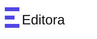

  <h1>Editora</h1>

  <p><strong>A free, accessible rich text editor (WYSIWYG) for React and the web.</strong><br>
  Modular plugins, light and dark themes, TypeScript types. MIT licensed.</p>

  <p>
    <a href="https://www.npmjs.com/package/@editora/core"></a>
    <a href="https://github.com/ajaykr089/Editora/actions/workflows/ci.yml"></a>
    <a href="./LICENSE"></a>
    
    <a href="https://github.com/ajaykr089/Editora/stargazers"></a>
  </p>

  <p>
    <a href="https://stackblitz.com/github/ajaykr089/Editora/tree/main/examples/stackblitz?file=src/App.jsx"><strong>Try it in your browser</strong></a> ·
    <a href="https://editora-ecosystem.netlify.app/">Docs</a> ·
    <a href="https://editora-free.netlify.app/">Web demo</a> ·
    <a href="https://editora-ecosystem-storybook.netlify.app/">Storybook</a> ·
    <a href="https://www.npmjs.com/org/editora">npm</a>
  </p>

  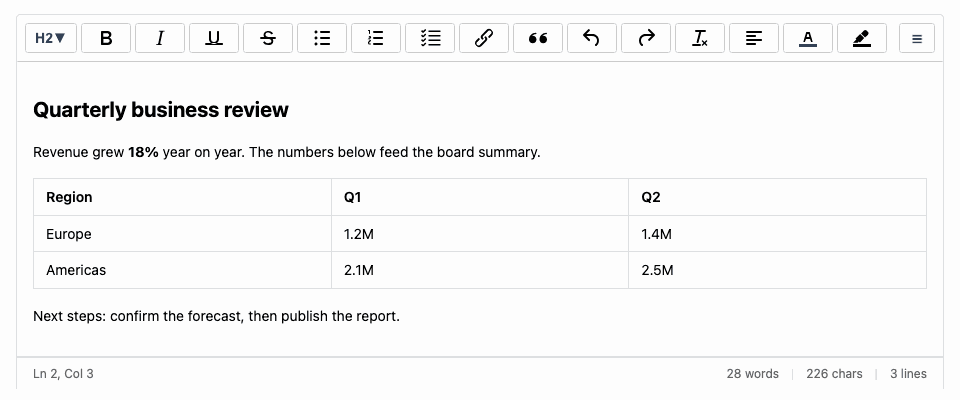
</div>

## Quick start

```bash
npm install @editora/react @editora/core @editora/plugins @editora/themes react react-dom
```

```tsx
import { useState } from 'react';
import { EditoraEditor } from '@editora/react';
import {
  BoldPlugin,
  HeadingPlugin,
  HistoryPlugin,
  ItalicPlugin,
  LinkPlugin,
  ListPlugin,
  UnderlinePlugin,
} from '@editora/plugins/lite';

import '@editora/themes/themes/default.css';
import '@editora/plugins/styles.css';

// Create the plugins once, outside the component (or with useMemo), so the editor is not rebuilt on every render.
const plugins = [
  HeadingPlugin(),
  BoldPlugin(),
  ItalicPlugin(),
  UnderlinePlugin(),
  ListPlugin(),
  LinkPlugin(),
  HistoryPlugin(),
];

const toolbar = {
  items: ['undo', 'redo', 'heading', 'bold', 'italic', 'underline', 'link', 'bullist', 'numlist'],
};

export default function App() {
  const [html, setHtml] = useState('<h2>Launch briefing</h2><p>Start writing, or paste something in.</p>');

  return (
    <EditoraEditor
      value={html}
      onChange={setHtml}
      plugins={plugins}
      toolbar={toolbar}
      placeholder="Start writing..."
    />
  );
}
```

Add plugins and the toolbar grows with them. The same editor is available as a web component for plain HTML, Vue, Angular and Svelte (`@editora/core`). **Free alternative to TinyMCE, Quill, Draft.js and Slate:** see an [honest comparison, including when not to use Editora](https://editora-ecosystem.netlify.app/docs/getting-started/alternatives).

Also available: a [CodeSandbox](https://codesandbox.io/p/github/ajaykr089/editora-codesandbox/main) and an [editor example](https://qjr47y-5173.csb.app/editora-editor).

## 🚀 Why Editora? (Free Premium Features)

### ✨ Best Free Features
- **30+ Free Plugins**: Table editor, code highlighting, accessibility checker, media manager, and more
- **33+ Keyboard Shortcuts**: Professional editing speed
- **Enterprise-Grade**: Security, performance, accessibility (WCAG compliant)
- **Open Source**: MIT licensed, completely free forever
- **No Subscriptions**: No paywalls, no limitations, no hidden costs

### Core Editing
- ✅ **Rich Text Formatting**: Bold, italic, underline, strikethrough
- ✅ **Headings**: H1-H6 with proper semantic structure
- ✅ **Lists**: Ordered and unordered lists with nesting
- ✅ **Blockquotes**: Quoted content blocks
- ✅ **Links**: URL management with validation
- ✅ **Media**: An [advanced media manager](packages/plugins/media-manager/README.md) for images, video, audio and embeds: library, uploads, image editing, captions
- ✅ **Tables**: Full table editing with resize and merge
- ✅ **Code Blocks**: Syntax highlighting for 30+ languages
- ✅ **History**: Undo/redo with configurable depth
- ✅ **Status Bar**: Real-time cursor position, word/character counts, and selection info

### Enterprise Features (All Free)
- ✅ **Security**: XSS protection, HTML sanitization, content validation
- ✅ **Performance**: Transaction batching, memory management, monitoring
- ✅ **Theming**: CSS variables, light/dark themes, runtime switching
- ✅ **Accessibility**: WCAG compliance, keyboard navigation, a11y checker
- ✅ **TypeScript**: Full type safety and IntelliSense
- ✅ **Framework Agnostic**: Core works with any framework

### Developer Experience
- ✅ **Plugin Architecture**: Everything is modular and extensible
- ✅ **Clean APIs**: Intuitive hooks and component interfaces
- ✅ **Modern Stack**: React 18, TypeScript 5, modern build tools
- ✅ **Tree Shaking**: Optimized bundle sizes
- ✅ **SSR Compatible**: Next.js and server-side rendering support
- ✅ **500+ Ready-to-Use Icons**: Generic UI icons, product icons, and logo icons via `@editora/icons` and `@editora/react-icons`

## 📸 Features Overview

<div align="center">
  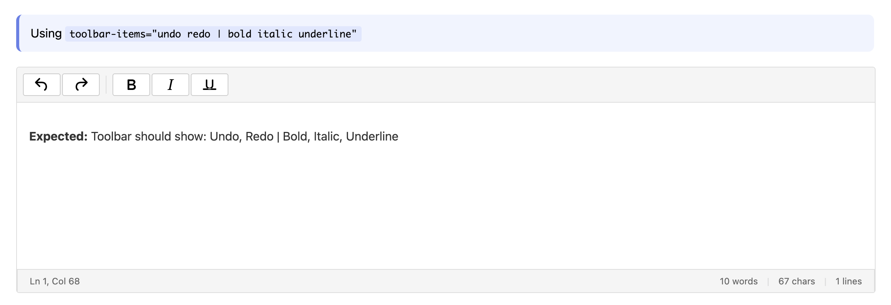
  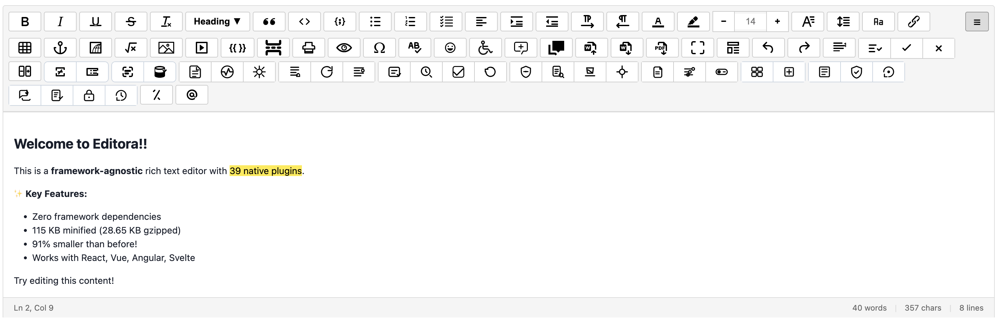
  <br>
  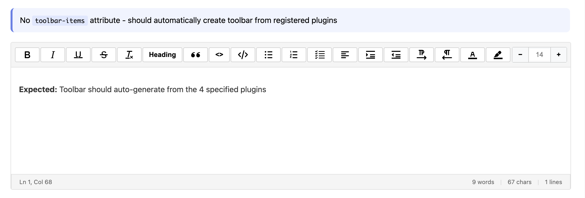
  
  <br>
  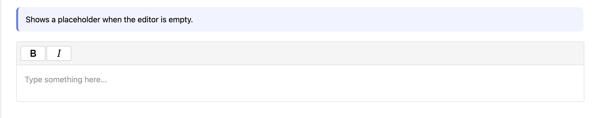
  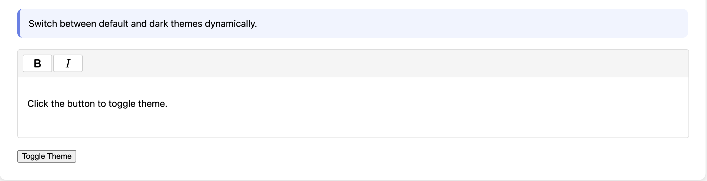
  <br>
  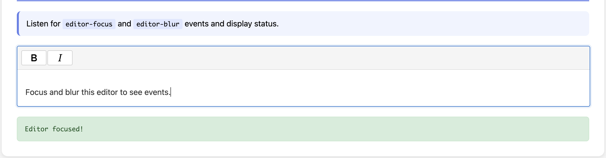
  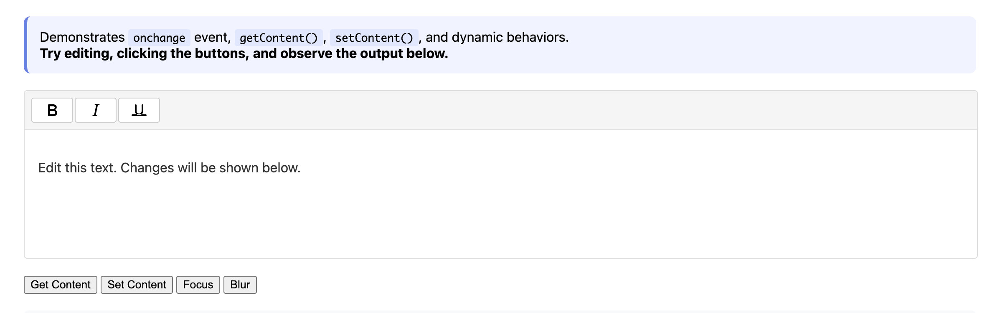
</div>

## 🖼️ Advanced Media Manager

Images, video, audio and embedded players go through one **Media** window instead of a bare file picker. It works with no backend at all (files stay in the document, and a library of what you uploaded is kept in the browser), and with your own storage through one function or a full provider.

<div align="center">
  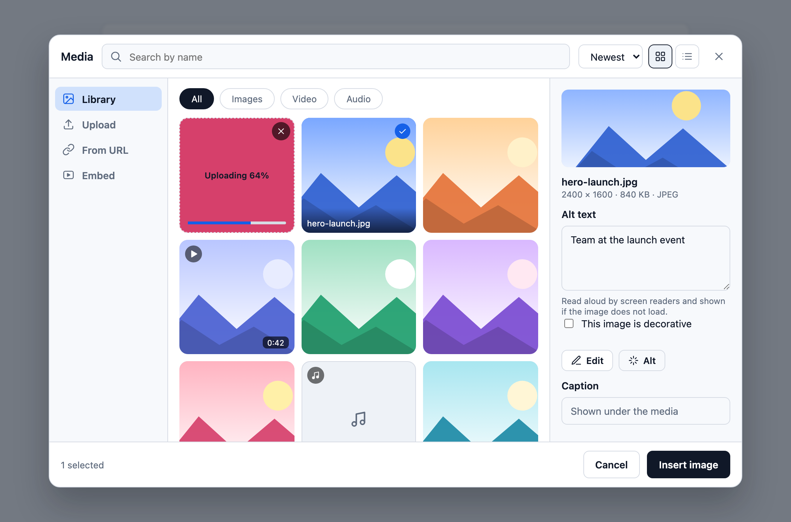
  <p><em>Library, upload progress inside the grid, and a details panel with alt text, caption, Edit and Alt</em></p>
</div>

- **One window for all media**: Library, Upload, From URL, Stock photos and Embed (YouTube and Vimeo) in a sidebar; All / Images / Video / Audio pills; search, sort and a grid or list layout.
- **Uploads you can see**: drop or paste files anywhere in the window and they appear in the grid with their own progress, cancel and retry. Paste or drop a picture straight into the document and it gets a placeholder where it will land.
- **Edit in place**: rotate, flip, crop to a shape, scale and re-encode with the built-in image editor, and keep the original.
- **Accessible by design**: alt text with a "decorative" switch and an optional **Alt** button that calls your own description service, captions as real `<figure><figcaption>`, keyboard control of the grid, the toolbar and resizing.
- **Bring your own backend**: `uploadHandler(file, { onProgress, signal })`, a `provider` with `list`, `update` and `delete`, or the REST API in [`api/`](api). Stock photo services plug in the same way.
- **Everywhere**: touch handles, a bottom sheet on phones, light and dark themes, tested in Chromium, Firefox and WebKit.

<div align="center">
  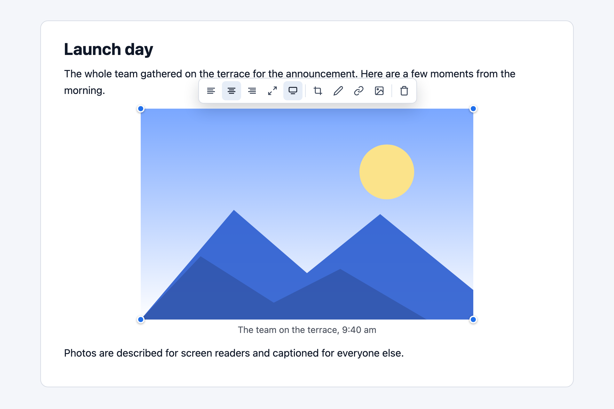
  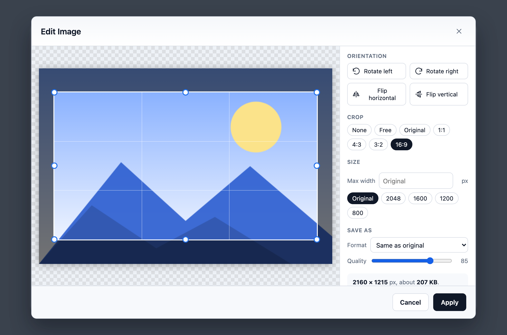
  <br>
  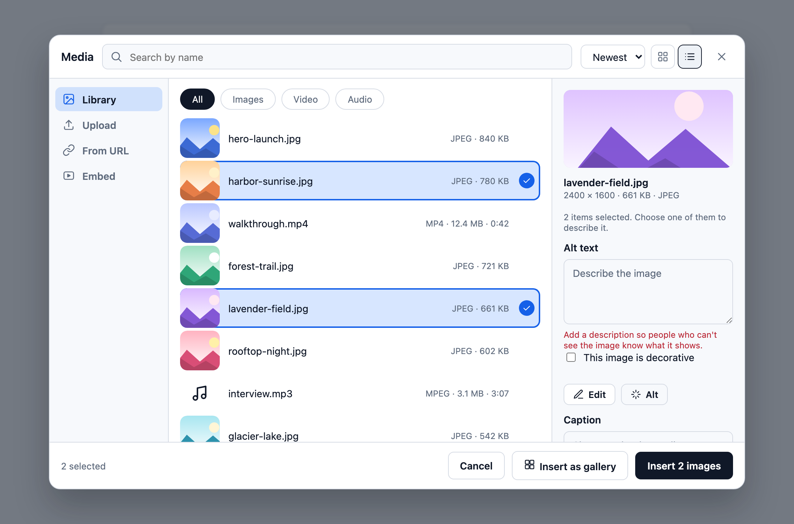
  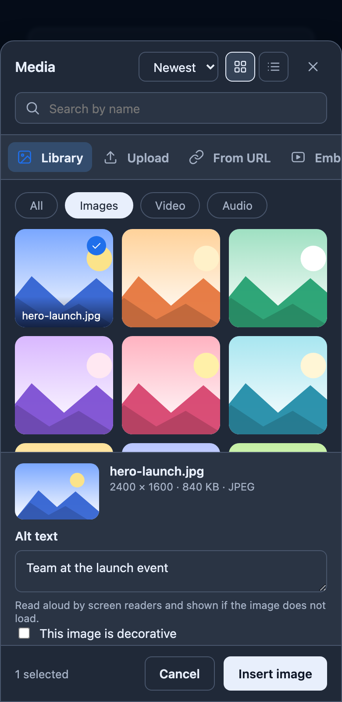
</div>

```ts
import { MediaManagerPlugin } from "@editora/plugins";

MediaManagerPlugin({
  uploadHandler: async (file, { onProgress, signal }) => (await myUpload(file, onProgress, signal)).url,
  optimizeImages: { maxWidth: 1600, quality: 0.85 },
});
```

See the [media manager guide](packages/plugins/media-manager/README.md) for providers, stock photos, suggested alt text, galleries and the REST API.

## 📦 Installation

```bash
npm install @editora/react @editora/core @editora/plugins @editora/themes react react-dom
```

Minimal React setup (no optional plugin/theme bundles):

```bash
npm install @editora/react @editora/core react react-dom
```

Bundle-size note:
Choose the import strategy based on your use case:
- `@editora/plugins` for the full catalog
- `@editora/plugins/lite` for common/core plugins
- `@editora/plugins/enterprise` for advanced/specialized workflows
- Per-plugin subpaths (for example `@editora/plugins/bold`, `@editora/plugins/spell-check`) for the smallest bundles

All three entry paths (`full`, `lite`, `enterprise`) are completely free and fully customizable.

### Enterprise Plugin Preset (`@editora/plugins/enterprise`)

Use the enterprise preset when you need advanced workflows (all free + customizable):

- Collaboration/workflow: `MentionPlugin`, `TrackChangesPlugin`, `VersionDiffPlugin`, `CommentsPlugin`, `ApprovalWorkflowPlugin`
- Validation/compliance: `ContentRulesPlugin`, `DocSchemaPlugin`, `A11yCheckerPlugin`, `SpellCheckPlugin`, `PIIRedactionPlugin`
- Structured/dynamic authoring: `ConditionalContentPlugin`, `DataBindingPlugin`, `MergeTagPlugin`, `TemplatePlugin`, `CitationsPlugin`
- Automation/productivity: `SmartPastePlugin`, `SlashCommandsPlugin`, `BlocksLibraryPlugin`, `TranslationWorkflowPlugin`
- Manager-backed advanced plugins: `MediaManagerPlugin`, `DocumentManagerPlugin`

## 🤖 AI-Ready Metadata

- **LLM Index:** [llms.txt](./llms.txt)
- **LLM Full Guide:** [llms-full.txt](./llms-full.txt)
- **Canonical Inventory:** [COMPONENT_INVENTORY.md](./COMPONENT_INVENTORY.md)
- **Component Registry:** [components.json](./components.json)
- **Registry Schema:** [components.schema.json](./components.schema.json)
- **Regenerate Registry:** `npm run generate:components`

### CLI Quick Add

```bash
npx @editora/cli add button
npx @editora/cli add modal
npx @editora/cli add datatable
npx @editora/cli add editor
npx @editora/cli add toast
npx @editora/cli add accordion
npx @editora/cli add ui-select
```

## 🏗️ Architecture

### Package Structure
```
packages/
├── core/              # Framework-agnostic editor engine
├── react/             # React integration layer
├── plugins/           # 11 modular plugins
│   ├── bold/         # Text formatting
│   ├── italic/
│   ├── heading/
│   ├── paragraph/
│   ├── history/      # Undo/redo
│   ├── list/         # Bullet/numbered lists
│   ├── blockquote/
│   ├── table/        # Advanced tables
│   ├── image/        # Upload & management
│   ├── link/         # URL management
│   ├── codeblock/    # Syntax highlighting
├── themes/           # Theming system
└── performance/      # Optimization utilities
```

### Core Concepts

#### Plugin-First Architecture
Everything is a plugin - from basic formatting to advanced features. This ensures:
- **Modularity**: Easy to add/remove features
- **Maintainability**: Isolated concerns
- **Extensibility**: Custom plugins without core changes
- **Performance**: Lazy loading and tree shaking

#### Immutable State Management
- **Transaction-Based**: All changes are atomic
- **Structural Sharing**: Efficient memory usage
- **Undo/Redo**: Built-in history management
- **Collaboration Ready**: CRDT-compatible architecture

#### Schema-Driven Content
- **AST-Based**: Documents as JSON-serializable trees
- **Type Safety**: Runtime validation
- **Extensibility**: Custom node and mark types
- **Serialization**: HTML ↔ JSON conversion

## 💻 Usage

### Basic Setup

```typescript
import { EditoraEditor } from '@editora/react';

import "@editora/themes/themes/default.css";
import {
  BoldPlugin,
  ItalicPlugin,
  HeadingPlugin,
  HistoryPlugin
} from '@editora/plugins';

function MyEditor() {
  const [content, setContent] = useState('<p>Start writing...</p>');

  return (
    <EditoraEditor
      value={content}
      onChange={setContent}
      plugins={[
        BoldPlugin(),
        ItalicPlugin(),
        HeadingPlugin(),
        HistoryPlugin()
      ]}
    />
  );
}
```

### Status Bar Configuration

Editora includes a comprehensive status bar that displays real-time editing information.

```typescript
function EditorWithStatusBar() {
  return (
    <EditoraEditor
      statusbar={true}
      plugins={[
        BoldPlugin(),
        ItalicPlugin(),
        HeadingPlugin(),
        HistoryPlugin()
      ]}
    />
  );
}
```

#### Status Bar Features
- **Left Section**: Cursor position (Ln X, Col Y) and selection information
- **Right Section**: Word count, character count, and line count
- **Real-time Updates**: Information updates as you type and move the cursor
- **Selection Tracking**: Shows selected character and word counts when text is selected

#### Web Component Status Bar

```html
<editora-editor
  statusbar="true"
  plugins="bold italic underline history"
  toolbar-items="bold italic underline | undo redo"
>
  <p>Start editing to see status bar updates...</p>
</editora-editor>
```

### Advanced Configuration

```typescript
import { EditoraEditor } from '@editora/react';
import { MediaManagerPlugin, TablePlugin } from '@editora/plugins';
import { createPerformanceMonitor } from '@editora/performance';

const mediaPlugin = MediaManagerPlugin({
  uploadUrl: '/api/upload',
  maxSize: 5 * 1024 * 1024, // 5MB
  allowedTypes: ['image/jpeg', 'image/png']
});

const tablePlugin = TablePlugin();
const monitor = createPerformanceMonitor();

function AdvancedEditor() {
  return (
    <EditoraEditor
      plugins={[mediaPlugin, tablePlugin]}
      onInit={(editor) => {
        // Performance monitoring
        monitor.startOperation('editor-init');
        monitor.endOperation();
      }}
    />
  );
}
```

### Web Component Usage

Editora provides a framework-agnostic web component that works with any JavaScript framework or vanilla HTML.

```html
<!DOCTYPE html>
<html>
<head>
  <meta charset="UTF-8">
  <title>Editora Web Component</title>
  <script type="module" src="https://cdn.jsdelivr.net/npm/@editora/core/dist/webcomponent.js"></script>
  <link rel="stylesheet" href="https://cdn.jsdelivr.net/npm/@editora/core/dist/webcomponent.min.css">
</head>
<body>
  <editora-editor
    plugins="bold italic underline history"
    toolbar-items="bold italic underline | undo redo"
    height="300"
  >
    <p>Start editing your content here...</p>
  </editora-editor>

  <script>
    // Access the editor programmatically
    const editor = document.querySelector('editora-editor');
    
    // Get content
    const content = editor.innerHTML;
    
    // Set content
    editor.innerHTML = '<p>New content</p>';
    
    // Get API for advanced operations
    const api = editor.getAPI();
    if (api) {
      console.log('Editor content:', api.getContent());
    }
  </script>
</body>
</html>
```

#### Web Component Attributes

- `plugins`: Space-separated list of plugin names (e.g., "bold italic underline history")
- `toolbar-items`: Space-separated toolbar configuration with `|` for groups
- `height`: Editor height in pixels
- `placeholder`: Placeholder text when editor is empty

#### Available Plugins

All 37+ native plugins are available: `bold`, `italic`, `underline`, `strikethrough`, `link`, `table`, `list`, `history`, `heading`, `blockquote`, `code`, `textColor`, `backgroundColor`, `fontSize`, `fontFamily`, `textAlignment`, `indent`, `image`, `anchor`, `embedIframe`, `math`, `specialCharacters`, `emojis`, `a11yChecker`, `comments`, `fullscreen`, and more.

## 🌐 Web Component Demo

<div align="center">
  
  <p><em>Editora Web Component - Framework Agnostic Rich Text Editing</em></p>
</div>

```typescript
import '@editora/themes'; // Base theme
import '@editora/themes/dark.css'; // Dark theme
import { setGlobalTheme } from '@editora/themes';

// Apply dark theme
setGlobalTheme('dark');
```

## 🎨 Theme Comparison

<div align="center">
  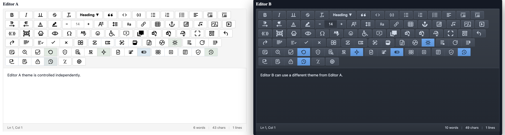
  <p><em>Editora supports both light and dark themes with seamless switching</em></p>
</div>

### Security Integration

```typescript
import { defaultSanitizer, ContentValidator } from '@editora/core';

// Sanitize user input
const cleanContent = defaultSanitizer.sanitize(userInput);

// Validate content
const validation = ContentValidator.validateText(cleanContent);
if (!validation.valid) {
  console.warn('Security warnings:', validation.warnings);
}
```

## 🔌 Plugin API

### Creating Custom Plugins

```typescript
import { Plugin } from '@editora/core';

const myCustomPlugin: Plugin = {
  name: 'my-plugin',
  nodes: {
    highlight: {
      attrs: { color: { default: 'yellow' } },
      parseDOM: [{ tag: 'mark' }],
      toDOM: (mark) => ['mark', { style: `background: ${mark.attrs.color}` }, 0]
    }
  },
  commands: {
    toggleHighlight: (state, dispatch) => {
      // Implementation
      return true;
    }
  },
  toolbar: [{
    id: 'highlight',
    icon: '🖍️',
    label: 'Highlight',
    command: 'toggleHighlight'
  }],
  keybindings: {
    'Mod-Shift-H': 'toggleHighlight'
  }
};
```

## 🔌 Plugin Architecture

<div align="center">
  
  <p><em>Modular Plugin System - Everything is a Plugin</em></p>
</div>
```

## 🎨 Customization

### CSS Variables

```css
:root {
  --rte-color-primary: #007bff;
  --rte-color-text-primary: #212529;
  --rte-font-family-base: 'Inter', sans-serif;
  /* 30+ customizable variables */
}
```

### Plugin Configuration

```typescript
const imagePlugin = MediaManagerPlugin({
  uploadUrl: '/api/upload',
  maxSize: 10 * 1024 * 1024,
  allowedTypes: ['image/jpeg', 'image/png', 'image/webp'],
  uploadFunction: async (file) => {
    // Custom upload logic
    return await uploadToCloud(file);
  }
});
```

## 🚀 Performance

### Optimization Features
- **Transaction Batching**: Group multiple operations
- **Debounced Updates**: UI responsiveness optimization
- **Memory Management**: Automatic cleanup and monitoring
- **Virtual Scrolling**: Large document support
- **Lazy Loading**: Plugin loading on demand

### Monitoring

```typescript
import { createPerformanceMonitor } from '@editora/performance';

const monitor = createPerformanceMonitor();

// Track operations
monitor.startOperation('render');
// ... operation
const metrics = monitor.endOperation();

console.log('Render time:', metrics.renderTime, 'ms');
console.log('Memory usage:', metrics.memoryUsage, 'MB');
```

## ⚡ Performance Monitoring

<div align="center">
  
  <p><em>Built-in Performance Monitoring and Optimization</em></p>
</div>

## 🔒 Security

### Built-in Protections
- **HTML Sanitization**: Configurable tag/attribute filtering
- **URL Validation**: Protocol and domain checking
- **File Upload Security**: Size and type validation
- **XSS Prevention**: Content validation and filtering
- **DoS Protection**: Nesting and size limits

### Content Validation

```typescript
import { ContentValidator } from '@editora/core';

// Validate text content
const result = ContentValidator.validateText('<script>alert(1)</script>');
// result.valid = false, warnings include XSS detection

// Validate file uploads
const fileResult = ContentValidator.validateFile(file, {
  maxSize: 5 * 1024 * 1024,
  allowedTypes: ['image/jpeg', 'image/png']
});
```

## 🧪 Testing

```bash
# Run all tests
npm test

# Run specific package tests
npm test -- packages/core

# Run with coverage
npm run test:coverage
```

## 🧩 UI Components

Editora also ships a production UI component system through `@editora/ui-core` and `@editora/ui-react`. The latest Gantt planning workspace includes task, summary, and milestone bars; dependency links; drag/resize editing; baselines; critical tasks; split segments; keyboard selection; links you draw by dragging; a two-level time header with weekend and holiday shading; scheduling that pushes later tasks and a computed critical path; in-place rename and task creation; translatable labels; SVG export and printing; bar design variants; and row virtualization for large plans.

- **React package:** `@editora/ui-react`
- **Web Components package:** `@editora/ui-core`
- **Gantt demos:** https://qjr47y-5173.csb.app/gantt and https://editora-ecosystem-storybook.netlify.app/?path=/story/ui-gantt--full-page-workspace

## 📚 API Documentation

### Core Classes
- **`EditorState`**: Immutable editor state with transactions
- **`Schema`**: Document structure definition
- **`Plugin`**: Extensible plugin base class
- **`Transaction`**: Atomic state changes

### React Components
- **`EditoraEditor`**: Main editor component
- **`Toolbar`**: Configurable button groups
- **`EditorContent`**: ContentEditable area

### Hooks
- **`useEditor`**: Access editor state and dispatch
- **`useCommand`**: Execute commands programmatically
- **`useSelection`**: Track selection changes

## 🤝 Contributing

### Development Setup

```bash
# Clone repository
git clone https://github.com/ajaykr089/Editora.git
cd Editora

# Install dependencies
npm install

# Start development
npm run dev

# Build packages
npm run build

# Run tests
npm test
```

### Plugin Development
1. Create plugin package in `packages/plugins/`
2. Implement plugin class extending base `Plugin`
3. Add schema extensions, commands, toolbar items
4. Write tests and documentation
5. Submit pull request

## 📄 License

MIT License - see [LICENSE](LICENSE) file for details.

## 🙏 Acknowledgments

Built with modern web technologies:
- **React 18** - UI framework
- **TypeScript 5** - Type safety
- **Rollup** - Module bundling
- **Jest** - Testing framework
- **Lerna** - Monorepo task running
- **Changesets** - Versioning and publishing

Inspired by modern editor architecture and best practices.

---

## 📞 Support

- **Documentation**: [Editora Ecosystem](https://editora-ecosystem.netlify.app/)
- **Issues**: [GitHub Issues](https://github.com/ajaykr089/Editora/issues)
- **Discussions**: [GitHub Discussions](https://github.com/ajaykr089/Editora/discussions)

---

**Rich Text Editor** - Enterprise-grade editing for modern web applications.
