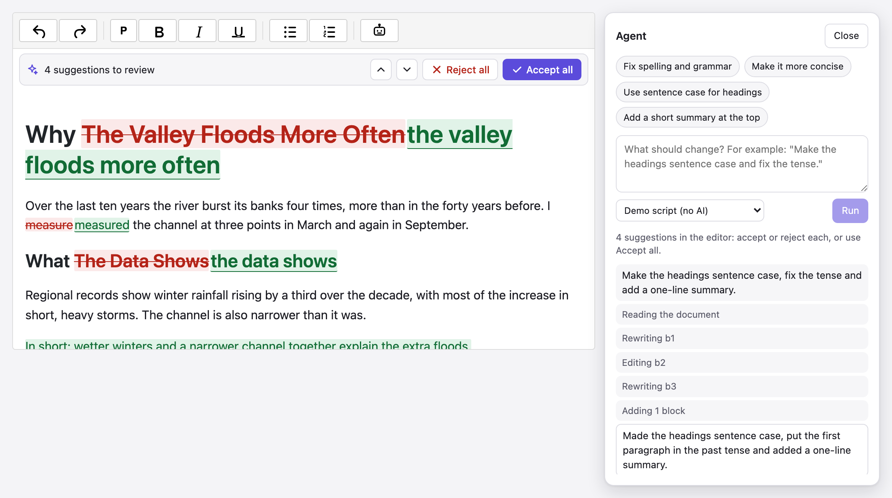
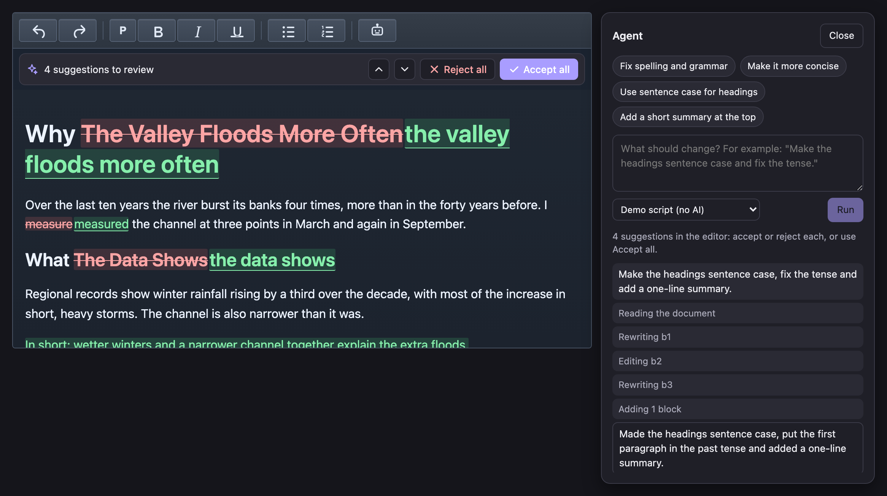
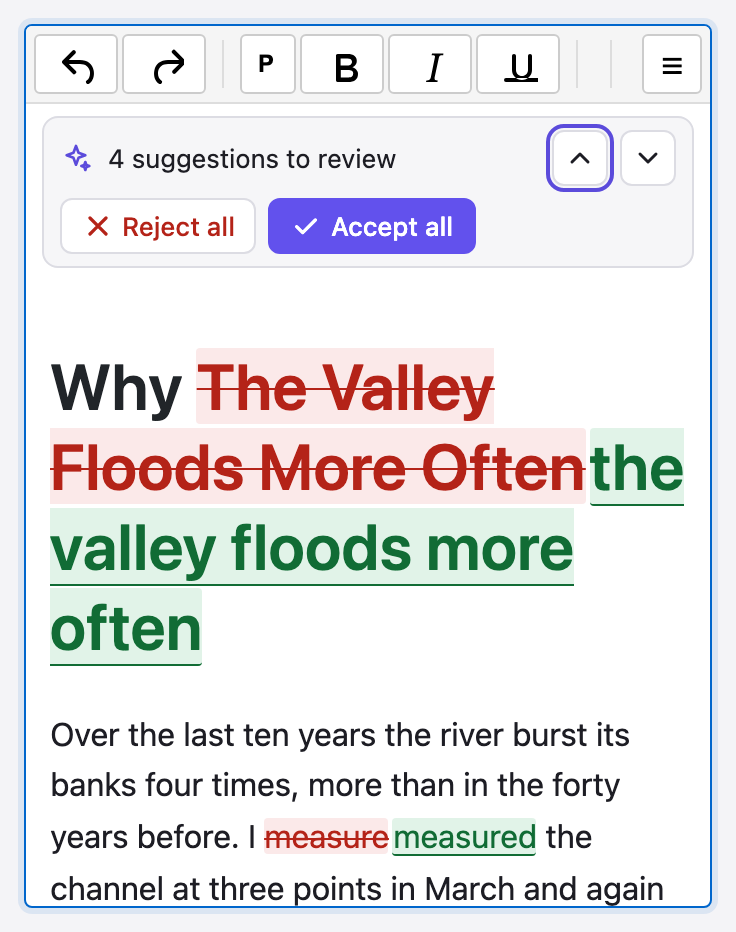

<h1 align="center">@editora/agent</h1>

<p align="center">
  <strong>An AI agent for your rich text editor, and an MCP server for the document you have open.</strong><br>
  Ask for a change in plain words ("make the headings sentence case and fix the tense"). The agent reads the whole
  document, edits it, and every edit appears as a suggestion to accept or reject. It works with Ollama, any
  OpenAI-compatible API, Claude, and MCP clients such as Claude Desktop, Claude Code and Cursor.
</p>

<p align="center">
  <a href="https://www.npmjs.com/package/@editora/agent"></a>
  <a href="https://www.npmjs.com/package/@editora/agent"></a>
  <a href="https://github.com/ajaykr089/Editora/blob/main/LICENSE"></a>
  <a href="https://www.npmjs.com/package/@editora/agent"></a>
</p>

<p align="center">
  <a href="https://editora-ecosystem.netlify.app/">Website</a> ·
  <a href="https://github.com/ajaykr089/Editora/tree/main/packages/agent/demo">Demo</a> ·
  <a href="https://github.com/ajaykr089/Editora">GitHub</a>
</p>

<p align="center">
  
</p>

Free and open source (MIT). It has no runtime dependencies besides
[`@editora/ai-review`](https://www.npmjs.com/package/@editora/ai-review), whose review bar shows the suggestions. It works
with any `contenteditable` editor and has a ready-made plugin for the [Editora](https://www.npmjs.com/package/@editora/core)
rich text editor, in plain JavaScript or [React](https://www.npmjs.com/package/@editora/react).

## Why

- **Whole-document edits, safely.** An agent can change twelve paragraphs at once, and nothing changes behind your back:
  every edit is a suggestion, and an accepted run is one undo step.
- **Your choice of model.** Use a free local model through Ollama, any OpenAI-compatible API (OpenAI, Groq, OpenRouter,
  Mistral, LM Studio, vLLM…) or Claude. Keys can stay on your server.
- **Bring your own agent.** The document tools are plain JSON-schema functions, so they work in your own agent loop. An
  MCP server lets desktop agents edit the page you have open.

## Features

- **Seven document tools:** `get_document`, `get_selection`, `search`, `replace_text`, `rewrite_block`, `insert_blocks`
  and `delete_blocks`. They work on blocks (headings, paragraphs, list items, quotes, table cells) with ids that last for
  one run and are never written into your HTML.
- **Suggestions, not silent edits:**
  - Rewrites are diffed word by word, so the formatting of untouched words is kept.
  - Deleted blocks are struck out.
  - New blocks appear where the agent asked, and disappear again if you reject them.
  - `mode: 'apply'` makes the edits directly instead.
- **Safe with people typing:** if you change a block while the agent works, your text wins and the agent's edit to that
  block is dropped. A new run waits until the previous suggestions are decided.
- **Chat panel:** ready-made prompts, a model picker, a live log of what the agent does, Stop, keyboard shortcut
  (Mod+Shift+K), light and dark themes, and a layout that steps aside on phones so you can review.
- **Agent loop:**
  - Runs with any provider and stops at the answer, a step limit (12 by default), Stop, or a refusal.
  - Reasoning models get their earlier thinking back, which Ollama's gpt-oss needs.
- **MCP server** (`editora-mcp`): Claude Desktop, Claude Code, Cursor or any MCP client can read and edit the document in
  your browser. It listens on 127.0.0.1 only, needs a pairing token, and checks the page's origin.
- **Labelled for AI disclosure:** suggestions carry `data-provenance="ai"` and the model, so
  [`@editora/authorship`](https://www.npmjs.com/package/@editora/authorship) labels accepted text with the model or MCP
  client that wrote it.
- **Works with:** Chrome, Edge, Firefox and Safari, Node 18+ (tools, loop, providers, MCP), and TypeScript.

## Install

```bash
npm install @editora/agent @editora/ai-review
```

## Quick start

### With the Editora editor

```js
import { AgentPlugin } from '@editora/agent/editora';
import { createOllamaAgentProvider } from '@editora/agent';

editor.setConfig({
  plugins: ['bold', 'italic', 'history', AgentPlugin({
    providers: [
      { id: 'local', label: 'Ollama · gpt-oss', create: () => createOllamaAgentProvider({ model: 'gpt-oss:20b-cloud' }) },
    ],
  })],
  toolbar: 'undo redo | bold italic | openAgent',
});
```

Press **Agent** (or Mod+Shift+K), say what to change, and review the suggestions. With
[Ollama](https://ollama.com) running on the same machine, `gpt-oss:20b-cloud` and `gemma4:31b-cloud` are free after
`ollama signin`. A local Ollama accepts requests from localhost pages.

### Keys on your server

```js
// Browser
import { createProxyAgentProvider } from '@editora/agent';
AgentPlugin({ provider: createProxyAgentProvider({ url: '/api/agent', provider: 'openai' }) });

// Server: any fetch-style handler (Next.js route handlers, Cloudflare Workers, Deno…)
import { createAgentHandler, toNodeHandler } from '@editora/agent/server';
import { createOpenAICompatibleAgentProvider } from '@editora/agent';

export const POST = createAgentHandler({
  providers: {
    openai: () => createOpenAICompatibleAgentProvider({ baseUrl: 'https://api.openai.com/v1', model: 'gpt-4.1', apiKey: process.env.OPENAI_API_KEY }),
  },
});
// Node http / Express: app.post('/api/agent', toNodeHandler(handler))
```

The server runs one model turn per request. The tools still run in the page, so the document goes only to the model.

### Claude

```js
import Anthropic from '@anthropic-ai/sdk';
import { createAnthropicAgentProvider } from '@editora/agent/anthropic';

const provider = createAnthropicAgentProvider({ client: new Anthropic() }); // claude-opus-5-5, effort "low"
```

The Claude provider has these defaults:

- **Effort:** `low` (editing a document is routine tool use).
- **Refusals:** Anthropic's server-side fallback is on.
- **Thinking:** Claude's own content is sent back unchanged, so its thinking blocks survive between turns.
- **Server:** use it inside `createAgentHandler`, which keeps the key on the server.

### Any contenteditable, your own UI

```js
import { attachAgent, createAgentPanel, createOllamaAgentProvider } from '@editora/agent';

const agent = attachAgent(document.querySelector('#editor'), { provider: createOllamaAgentProvider() });
createAgentPanel(agent).show();                        // the ready-made panel, or…
const { suggestions } = await agent.run('Fix spelling and grammar');
```

## Use it from Claude Desktop, Claude Code or Cursor (MCP)

1. Add the server to your MCP client, with a token of your choice:

   ```json
   {
     "mcpServers": {
       "editora": {
         "command": "npx",
         "args": ["-y", "-p", "@editora/agent", "editora-mcp"],
         "env": { "EDITORA_MCP_TOKEN": "a-long-random-secret" }
       }
     }
   }
   ```

   For Claude Code: `claude mcp add editora --env EDITORA_MCP_TOKEN=a-long-random-secret -- npx -y -p @editora/agent editora-mcp`.

2. Connect your page to the bridge:

   ```js
   AgentPlugin({ mcp: { url: 'http://127.0.0.1:41820', token: 'a-long-random-secret' } });
   ```

3. Ask your agent: "In the Editora document, shorten the introduction and fix the headings."

The agent's edits appear in the page as suggestions once it pauses. A burst of tool calls becomes one review.

How the connection is secured:

- The bridge listens on 127.0.0.1 only.
- Every request needs the token.
- Only localhost pages may connect, plus any you add with `--origin https://your.app`.
- Chrome's Private Network Access preflight is answered, so an https page can reach the local bridge.
- Run `editora-mcp --help` for the port and other options.

## How edits become suggestions

| Tool | In the editor |
| --- | --- |
| `replace_text`, `rewrite_block` | Changed words struck out and the new ones inserted; formatting of untouched words kept |
| `delete_blocks` | The block struck out; accepting removes it |
| `insert_blocks` | A new heading, paragraph, list item or quote after the given block (or at the start); rejecting removes it |

All edits from one run share one review bar (Previous, Next, Reject all, Accept all). Accepting is one undo step in
Editora. An agent reads pending suggestions as if they were accepted, but a new run starts only once they're decided.

## Your own agent loop

```js
import { readEditor, createDocumentTools, commitDraft, runAgent } from '@editora/agent';

const snapshot = readEditor(editorElement);                 // blocks + ids for this run
const tools = createDocumentTools(snapshot.draft);          // [{ name, description, parameters, run }]

// …give `tools` to your framework, or use the built-in loop:
await runAgent({ provider, tools, instruction: 'Tighten every paragraph' });

commitDraft(editorElement, snapshot, { model: 'my-model' }); // show the run as suggestions
```

The tools work on an in-memory draft, so they also run headless (Node, workers) on plain blocks with
`new DraftDocument(blocks)`. Converters for OpenAI, Ollama and Anthropic message formats are exported too.

## Editora plugin options

| Option | Default | |
| --- | --- | --- |
| `provider` / `providers` | none | The model, or a list the user picks from (`{ id, label, create }`) |
| `mode` | `'suggest'` | `'apply'` makes edits directly (one undo step) |
| `maxSteps` | `12` | Model turns before a run stops |
| `system` | built in | Replaces the system prompt |
| `mcp` | none | `{ url, token }` for `editora-mcp` |
| `shortcut` | `'Mod-Shift-k'` | `false` for none |
| `labels` | English | Text for the panel |
| `onReady` | none | Called with each editor's controller |

Commands: `openAgent`, `runAgent` (with an instruction), `stopAgent`, `getAgent`.

<p align="center">
  
</p>

<p align="center">
  
</p>

## Try the demo

```bash
npm run build -w @editora/core -w @editora/ai-review -w @editora/authorship -w @editora/agent
node packages/agent/demo/server.mjs
```

Open http://localhost:5199 and pick a model:

- **Demo script (no AI)** makes fixed edits without a model.
- **Ollama** models need Ollama on this machine.
- `?theme=dark` shows the dark theme.
- `?mcp=1` connects the page to `editora-mcp`, run with `EDITORA_MCP_TOKEN=demo-token-123`.
- `node packages/agent/demo/screenshots.mjs` regenerates the pictures in this README.

## Limits

- Edits are text edits. The agent can reword, add and remove blocks, but it doesn't change formatting (bold, links),
  tables or images yet.
- Each run reads the document fresh; there's no memory of earlier runs.
- The MCP bridge serves one connected editor at a time (the most recent page to connect).
- Model quality varies: small local models may need a clearer instruction or a retry. The log shows every tool call,
  errors included.

## Related packages

- [`@editora/ai-review`](https://www.npmjs.com/package/@editora/ai-review): AI rewrites of a selection, as suggestions
- [`@editora/authorship`](https://www.npmjs.com/package/@editora/authorship): who or what wrote each part of a document
- [`@editora/core`](https://www.npmjs.com/package/@editora/core): the Editora rich text editor

## License

MIT
