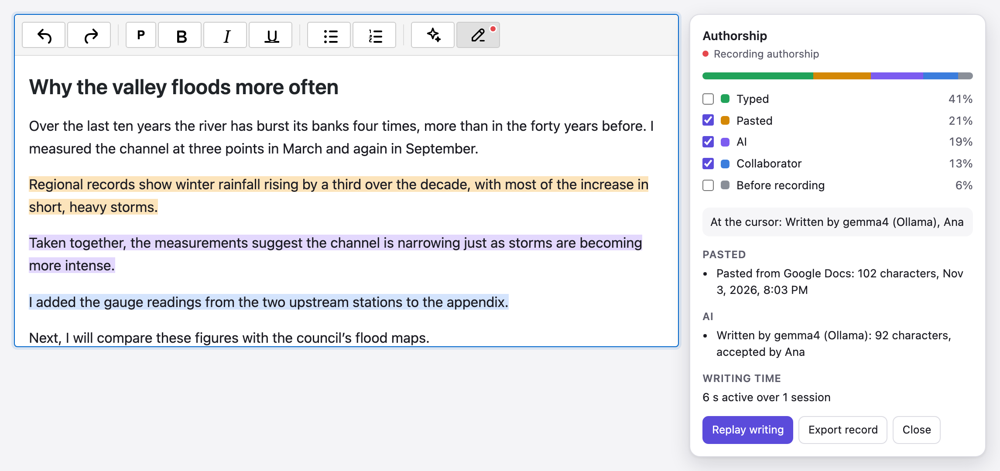
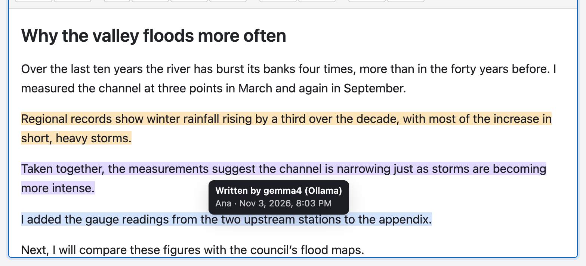
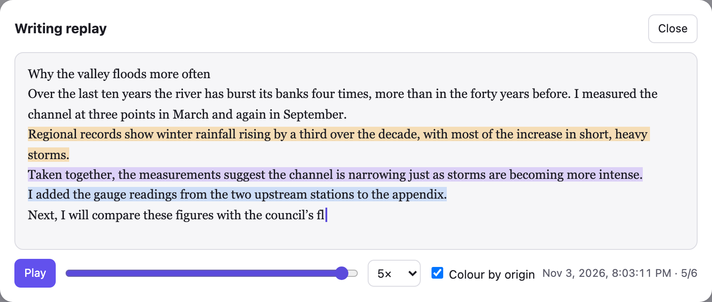
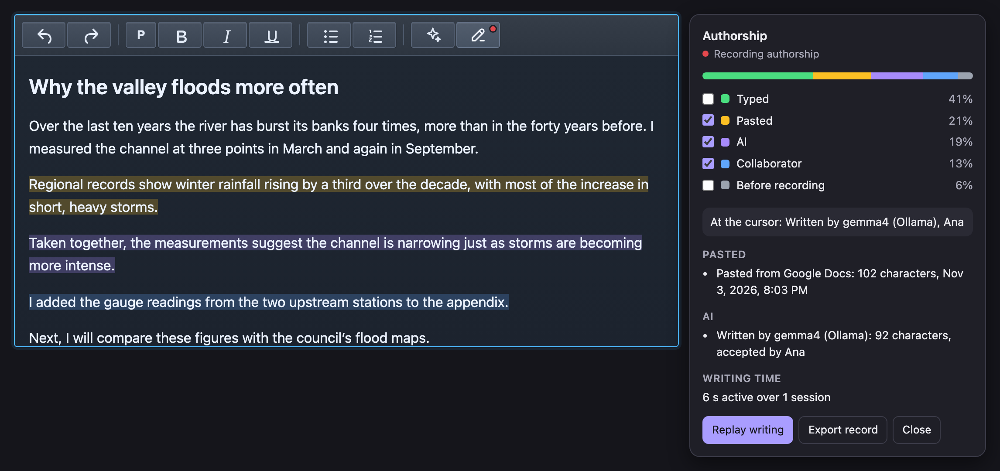

<h1 align="center">@editora/authorship</h1>

<p align="center">
  <strong>Authorship tracking and AI disclosure for rich text editors.</strong><br>
  See which parts of a document were typed, pasted (and from which app), written by AI (and which model) or added by a
  collaborator. Highlight them, replay how the document was written, and export a record a server can verify.
</p>

<p align="center">
  <a href="https://www.npmjs.com/package/@editora/authorship"></a>
  <a href="https://www.npmjs.com/package/@editora/authorship"></a>
  <a href="https://github.com/ajaykr089/Editora/blob/main/LICENSE"></a>
  <a href="https://www.npmjs.com/package/@editora/authorship"></a>
  <a href="https://bundlephobia.com/package/@editora/authorship"></a>
</p>

<p align="center">
  <a href="https://editora-ecosystem.netlify.app/">Website</a> ·
  <a href="https://github.com/ajaykr089/Editora/tree/main/packages/authorship/demo">Demo</a> ·
  <a href="https://github.com/ajaykr089/Editora">GitHub</a>
</p>

<p align="center">
  
</p>

Free, open source (MIT) and with no dependencies. It works with any `contenteditable` editor and has a ready-made
plugin for the [Editora](https://www.npmjs.com/package/@editora/core) rich text editor, in plain JavaScript or
[React](https://www.npmjs.com/package/@editora/react). Your HTML is never changed: origins are kept in a separate
record that you save next to the content.

## Why

- **Schools and course platforms** want to see how an essay was written, not just the final text.
- **Publishers, newsrooms and marketing teams** need to label AI-written content, and AI transparency rules such as
  the EU AI Act's are coming into force.
- **Teams** want to know which parts of a contract or report came from where before they sign off.

AI detectors guess from the finished text and are often wrong. This package records the facts as they happen.

## Features

- **Origin of every character:** typed (by whom), pasted (from Word, Google Docs, Google Sheets, Excel, LibreOffice,
  Apple apps, VS Code or a web page), AI-written (model and provider), collaborator, editor tool, or changed outside
  the editor.
- **Highlights and hover details:** shade text by origin, with no change to the DOM, and hover to see who added it,
  when and from where.
- **Summary panel:** the share of the document from each origin, pastes, AI inserts, writing time, and the origin of
  the text at the cursor (announced to screen readers).
- **Writing replay:** play back how the document was written, coloured by origin, with a timeline and speeds up to 50×.
- **AI disclosure export:** annotated HTML with `data-provenance` attributes, IPTC digital source type terms, and the
  full record embedded as JSON.
- **Tamper-evident record:** a hash-chained log, plus a witness server that signs it as people write. It only ever
  sees hashes, never the text.
- **Keeps origins when text moves:** cut and paste, copy between editors, drag and drop, and undo or redo.
- **Fast:** 2 to 4 ms per keystroke in a 100,000-character document.
- **Works with:** Chrome, Edge, Firefox and Safari, plus React, plain JavaScript and Node 18+ (headless engine and
  server). Typed for TypeScript, including `moduleResolution: "NodeNext"`.

## Install

```bash
npm install @editora/authorship
```

## Quick start

### With the Editora editor

```js
import { AuthorshipPlugin } from '@editora/authorship/editora';

editor.setConfig({
  plugins: ['bold', 'italic', 'history', AuthorshipPlugin({
    author: currentUser.name,
    state: savedRecord,                        // optional: continue an earlier record
    onReady: (authorship) => (window.authorship = authorship),
  })],
  toolbar: 'undo redo | bold italic | toggleAuthorship',
});
```

The **Authorship** toolbar button shows a red dot while it records and opens the panel.

### With React

```jsx
import { EditoraEditor } from '@editora/react';
import { BoldPlugin, ItalicPlugin, HistoryPlugin } from '@editora/plugins/lite';
import { AuthorshipPlugin } from '@editora/authorship/editora';

const plugins = [BoldPlugin(), ItalicPlugin(), HistoryPlugin(), AuthorshipPlugin({ author: 'Ana' })];

export function Essay() {
  return <EditoraEditor plugins={plugins} toolbar={{ items: ['undo', 'redo', 'bold', 'italic', 'toggleAuthorship'] }} />;
}
```

In React, the plugin starts recording the first time the editor is focused or edited.

### With any contenteditable editor

```js
import { attachAuthorship } from '@editora/authorship';

const authorship = attachAuthorship(document.querySelector('#editor'), { author: 'Ana', autoStart: true });

// Save the record with the document…
save({ html: editor.innerHTML, authorship: authorship.serialize() });

// …and read a summary.
const report = authorship.getReport();
report.byKind.pasted.share; // 0.21
report.ai;                  // [{ origin: { kind: 'ai', model: 'gemma4' }, chars: 412 }]
report.activeMs;            // time spent writing
```

## See it

<p align="center">
  
</p>

Hover any highlighted text to see where it came from.

<p align="center">
  
</p>

**Replay writing** plays the document back as it was written. Pauses longer than 1.5 seconds are shortened, so hours of
writing play in minutes. Only the text is replayed, not its formatting.

<p align="center">
  
</p>

The highlights, panel and replay follow the editor's light or dark theme.

## What it records and what it does not

This package records **where text came from**. It does **not** detect cheating, and it does not guess whether text was
written by AI.

- Everything is recorded in the browser, and a determined user can fake a log kept only there.
- Logs sent to a **witness** server as the person writes (see [below](#witness-server)) prove **when** each part of
  the text existed. They do not prove **who physically typed it**: a script can type too.
- Text that changes with no known cause (a browser extension, another script) is labelled `external` rather than
  guessed.

Use it to show people what is in a document and to label AI or pasted content honestly. Don't use it on its own as
proof of misconduct.

## Privacy

Recording only starts when you call `start()` (or pass `autoStart: true`). The Editora plugin starts by itself, because
adding it is the opt-in. While it records, the toolbar button shows a red dot and its label says "recording". Tell the
people writing that it is on.

By default typing is stored in bursts, not keystroke by keystroke (`timing: 'keystroke'` changes that). The package
sends nothing anywhere unless you set up a witness, and the witness only ever receives hashes, never text.

## Origins

| Kind | When |
| --- | --- |
| `existing` | Text that was there when recording started |
| `typed` | Typing, Enter, autocorrect (keeps the corrected text's origin), IME input |
| `pasted` | Paste or drop from outside. `source` is `word`, `google-docs`, `google-sheets`, `excel`, `libreoffice`, `apple`, `vscode`, `web` or `plain` |
| `ai` | Text inside an element with `data-provenance="ai"`, or announced with `expect({ kind: 'ai', model })` |
| `collaborator` | Remote edits announced by the collaboration plugin (or by you) |
| `tool` | Text the editor's own UI inserted (emoji picker, merge tags, slash menu) with no input event |
| `external` | Anything else |

### Labelling AI and other inserted text

Tools that insert text can label it either way, without importing this package:

```html
<!-- Any element around inserted text -->
<ins data-provenance="ai" data-provenance-model="gemma4:31b-cloud" data-provenance-provider="ollama">…</ins>
```

```js
// Or announce the next change
import { announceProvenance } from '@editora/authorship';
announceProvenance(editorElement, { kind: 'ai', model: 'gpt-oss:20b' });

// The same thing with no import:
editorElement.dispatchEvent(new CustomEvent('provenance:expect', { detail: { kind: 'ai', model: 'gpt-oss:20b' }, bubbles: true }));
```

[`@editora/ai-review`](https://www.npmjs.com/package/@editora/ai-review) marks its suggestions this way, and
[`@editora/collaboration`](https://www.npmjs.com/package/@editora/collaboration) announces remote edits. Accepted AI
rewrites and collaborators' text are labelled with no extra code.

## Editora plugin

| Option | Default | |
| --- | --- | --- |
| `author` | none | Name recorded for typed, pasted and accepted text |
| `state` | none | A saved record to continue |
| `autoStart` | `true` | Start recording when the editor is ready |
| `highlight` | pasted, AI, collaborator, tool, external | Kinds shaded when the panel is open |
| `witness` | none | `{ url, doc }`: send hashes to a [witness server](#witness-server) |
| `timing` | `'burst'` | `'keystroke'` keeps every keystroke for replay |
| `labels` | English | Text for the panel, tooltips and replay |
| `onReady` | none | Called with each editor's controller |
| `onExport` | download a file | Called by the panel's Export button with the record as JSON |

Commands: `toggleAuthorship`, `toggleAuthorshipHighlights`, `openAuthorshipReplay`, `startAuthorship`,
`stopAuthorship`, `getAuthorship` (returns the controller).

## Saving and loading

```js
const record = authorship.serialize();             // JSON: origins, runs, text, log
authorship.start(record);                           // after loading the same content again
```

If the content was edited somewhere that did not record authorship, the parts that differ become `external`.
`serialize({ log: false })` leaves out the log (smaller, but no replay or witness check), and
`serialize({ text: false })` leaves out the plain-text copy.

## AI disclosure export

```js
import { toAnnotatedHtml, readEmbeddedState, documentSourceType } from '@editora/authorship';

const html = toAnnotatedHtml(editorElement, authorship.serialize(), { embed: true });
// <p>… <span data-provenance="ai" data-provenance-model="gemma4" data-provenance-type="http://cv.iptc.org/newscodes/digitalsourcetype/trainedAlgorithmicMedia">…</span></p>
// <script type="application/vnd.editora.authorship+json">{…}</script>

const { html: clean, state } = readEmbeddedState(html);
documentSourceType(authorship.getReport()); // …/compositeWithTrainedAlgorithmicMedia when human and AI text are mixed
```

There is no standard for text provenance yet. The `data-provenance-type` values come from the IPTC Digital Source
Type vocabulary, which was built for images and video but is the closest widely used one.

## Replay

```js
import { openReplayView, createReplay } from '@editora/authorship';

const { log, origins } = authorship.serialize();
openReplayView(log, { origins });                   // the dialog: play/pause, timeline, speed, colour by origin

createReplay(log).at(timestamp).text;               // or rebuild the text at any moment yourself
```

## Witness server

A witness signs the log as it is written, using its own clock. Later edits to the log become detectable, and every
part of the text has a "seen by" time. The browser seals the log into hash-chained batches and sends **only the
hashes**.

```js
// Browser
attachAuthorship(element, { author: 'Ana', autoStart: true, witness: { url: '/api/authorship', doc: essay.id } });

// Server: any fetch-style handler (Next.js route handlers, Cloudflare Workers, Deno…)
import { createAuthorshipWitness, verifyWitnessed, toNodeHandler } from '@editora/authorship/server';

export const POST = createAuthorshipWitness({
  secret: process.env.AUTHORSHIP_SECRET,            // 16+ characters, server only
  store,                                            // optional { get(doc), set(doc, receipt) }: refuses a second history
  allowDoc: (doc, request) => canWrite(request, doc),
});
// Node http / Express: app.post('/api/authorship', toNodeHandler(witness))

// Checking a submitted record
const result = await verifyWitnessed(record, { secret: process.env.AUTHORSHIP_SECRET, doc: essay.id });
// { ok, problems: [], replayMatches: true, witnessedEvents: 412, totalEvents: 415, witnessedUntil: 1793706185852 }
```

`verifyWitnessed` checks four things:

- the log replays to the saved text;
- no event was changed after it was sealed;
- every receipt was signed by your witness;
- no event is dated after the witness saw it.

Without a `store`, the witness keeps no state and cannot notice someone building a second history for the same
document. Use a store if that matters to you.

## Headless

The engine runs anywhere on plain text, including Node and web workers:

```js
import { AuthorshipEngine, buildReport } from '@editora/authorship';

const engine = new AuthorshipEngine({ author: 'Ana' });
engine.reset('Intro.');
engine.update('Intro. Hello', { cause: 'type', origin: { kind: 'typed', author: 'Ana' } });
buildReport(engine.serialize()).byKind.typed.chars; // 5
```

## Try the demo

```bash
npm run build -w @editora/core && npm run build -w @editora/authorship
node packages/authorship/demo/server.mjs
```

Open http://localhost:5197. Type, paste, or use the buttons to add text from Google Docs, Word, AI or a collaborator.
Then open the panel, replay the writing and verify the record with the witness. `?theme=dark` shows the dark theme,
and `node packages/authorship/demo/screenshots.mjs` regenerates the pictures in this README.

## Limits

- Highlights use the CSS Custom Highlight API (Chrome and Edge 105+, Safari 17.2+, Firefox 140+). Other browsers get
  a positioned overlay.
- Origins only travel between editors on the same page. Moving text between browser tabs or apps counts as a paste.
- A collaborator's own record shows their text as typed. Other people's text appears as `collaborator`, without names.
  A record shared between collaborators is not built yet.

## Related packages

- [`@editora/ai-review`](https://www.npmjs.com/package/@editora/ai-review): AI rewrites as suggestions to accept or reject
- [`@editora/paste-cleaner`](https://www.npmjs.com/package/@editora/paste-cleaner): clean pastes from Word, Google Docs and the web
- [`@editora/content-a11y`](https://www.npmjs.com/package/@editora/content-a11y): accessibility checks for editor content
- [`@editora/core`](https://www.npmjs.com/package/@editora/core): the Editora rich text editor

## License

MIT
