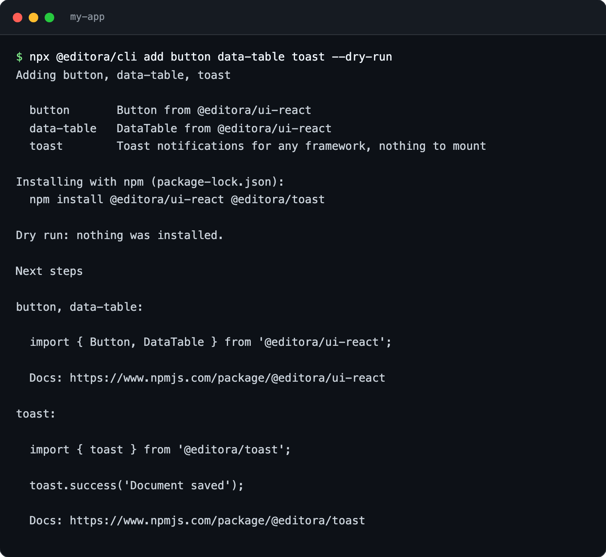
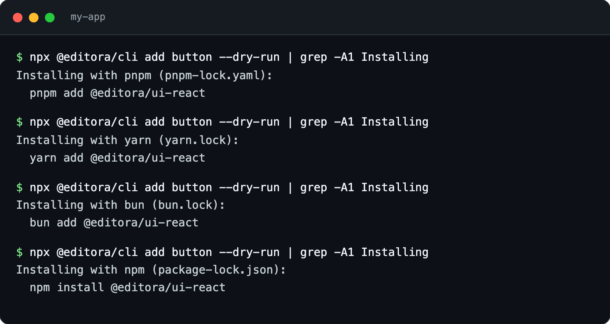

<h1 align="center">@editora/cli</h1>

<p align="center">
  Add Editora to a project with one command. <code>npx @editora/cli add editor</code> installs the rich text editor
  with your package manager, then shows the two imports and the five lines of code that put it on the page.
</p>

<p align="center">
  <a href="https://www.npmjs.com/package/@editora/cli"></a>
  <a href="https://www.npmjs.com/package/@editora/cli"></a>
  <a href="https://github.com/ajaykr089/Editora/blob/main/LICENSE"></a>
  <a href="https://www.npmjs.com/package/@editora/cli"></a>
</p>

<p align="center">
  <a href="https://editora-ecosystem.netlify.app/docs/reference/cli">Documentation</a> ·
  <a href="https://github.com/ajaykr089/Editora">GitHub</a>
</p>

<p align="center">
  
</p>

## What it does

- **`editora add <name>`** installs what a name needs (`editor`, `toast`, `data-table`, `docx`...), then prints the
  stylesheets to import once, in your app's entry file, and a few lines of code that use it.
- **`editora init`** looks at your project (the framework, where its entry file is, the package manager), asks what you
  want, and does the same.
- **`editora list`** shows every name, and searches them.

It uses the package manager your project uses, found from its lock file. It never edits your files: what changes is
what your package manager changes (`package.json`, the lock file, `node_modules`), and the code to add is printed for you
to paste. It has no dependencies and needs Node.js 16 or later.

## Quick start

In your project's folder:

```bash
npx @editora/cli init
npx @editora/cli add editor
```

Add `--dry-run` to see what it would do without installing anything:

```text
$ npx @editora/cli add editor --dry-run
Adding editor

  editor   Rich text editor for React

Installing with npm (package-lock.json):
  npm install @editora/react @editora/core @editora/plugins @editora/themes

Dry run: nothing was installed.

Next steps

Import the styles once, in src/main.tsx:

  import '@editora/themes/themes/default.css';
  import '@editora/plugins/styles.css';

editor:

  import { EditoraEditor } from '@editora/react';
  import { BoldPlugin, HistoryPlugin, ItalicPlugin, ListPlugin } from '@editora/plugins/lite';

  const plugins = [BoldPlugin(), ItalicPlugin(), ListPlugin(), HistoryPlugin()];

  <EditoraEditor plugins={plugins} />

  Docs: https://www.npmjs.com/package/@editora/react
```

To use it as a command, install it once and run `editora`:

```bash
npm install -g @editora/cli
editora add editor
```

## Set up a project

`editora init` says what it found, then asks what to set up. Answer with numbers or names (`2 4`, or `editor toast`).
In a React project it offers the React packages; in any other, the web components.

```text
$ npx @editora/cli init
Project          my-app (package.json)
Framework        Vite + React (styles go in src/main.tsx)
Package manager  npm (package-lock.json)

What do you want to set up? Name it, for example:
  editora init ui-react toast

  1  UI components                                        ui-react
  2  Rich text editor                                     editor
  3  Markdown editor                                      markdown-editor
  4  Toast notifications                                  toast
  5  Icons                                                react-icons
  6  Everything: UI, editor, toasts, icons, code editor   all
```

That is what it prints when it cannot ask (in CI, or with its output piped): name what you want instead.

```bash
npx @editora/cli init ui-react toast
```

## What you can add

| You type | It installs |
| --- | --- |
| `editor` | the rich text editor for React: `@editora/react`, `@editora/core`, `@editora/plugins`, `@editora/themes` |
| `web-editor` | the same editor as a web component, for any framework: `@editora/core` |
| `markdown-editor` | `@editora/markdown-editor`, `@editora/themes` |
| `light-code-editor` (or `code-editor`) | `@editora/light-code-editor` |
| `button`, `data-table`, `date-picker`, `modal`, ... | `@editora/ui-react`, once for all of them |
| `ui-core` (or `web-components`) | the same components as web components: `@editora/ui-core` |
| `ui-sortable` | drag-and-drop lists and boards on their own: `@editora/ui-sortable` |
| `toast` | `@editora/toast` |
| `icons`, `react-icons` | `@editora/icons`, `@editora/react-icons` |
| `ai-review`, `agent`, `authorship`, `collaboration` | the editor's AI, authorship and real-time packages |
| `paste-cleaner`, `content-a11y`, `rich-text-convert`, `email-html`, `docx` | the content tools |
| `ui-testing` | `@editora/ui-testing`, as a development dependency |
| `all` | UI components, toasts, the editor, icons and the code editor, for React |

`editora list` prints them all, with every component of [`@editora/ui-react`](https://www.npmjs.com/package/@editora/ui-react),
and searches them:

```text
$ npx @editora/cli list date
UI components  from @editora/ui-react, add any of them by name
  date-field  date-picker  date-range-picker  date-range-time-picker  date-time-picker
```

How names are read:

- A component can be written the way you like: `data-table`, `datatable` and `DataTable` are the same. Parts of a
  compound component, such as `AlertTitle`, come with the component they belong to. `modal` is `Dialog`.
- A package name works too: `editora add @editora/docx`.
- A leading `ui-` is allowed, so `ui-select` is `select`, except for the names that are packages of their own:
  `ui-react`, `ui-core`, `ui-sortable`, `ui-editor` and `ui-testing`.
- `toast` is the notification package, `@editora/toast`; `ui-toast` is the toast component of `@editora/ui-react`.

## Several at once

Give as many names as you like. The packages are installed with one command, a package that two names share is
installed once, and the components share one import line:

```text
$ npx @editora/cli add button modal toast --dry-run
Adding button, modal, toast

  button   Button from @editora/ui-react
  modal    Dialog from @editora/ui-react
  toast    Toast notifications for any framework, nothing to mount

Installing with npm (package-lock.json):
  npm install @editora/ui-react @editora/toast

Dry run: nothing was installed.

Next steps

button:

  import { Button } from '@editora/ui-react';

  Docs: https://www.npmjs.com/package/@editora/ui-react

modal:

  import { Dialog } from '@editora/ui-react';

  Docs: https://www.npmjs.com/package/@editora/ui-react

toast:

  import { toast } from '@editora/toast';

  toast.success('Document saved');

  Docs: https://www.npmjs.com/package/@editora/toast
```

## Choose the package manager

The CLI uses the package manager your project uses, whichever way you start it, `npx` included. Going up from the current
folder, the first folder that has one of these decides:

1. the `packageManager` field of its `package.json` (the one Corepack reads)
2. a lock file: `pnpm-lock.yaml`, `yarn.lock`, `bun.lock` or `bun.lockb`, `package-lock.json`

So in a workspace package, the lock file at the root of the repository is found. With no lock file, it uses the tool that
started it (`pnpm dlx`, `yarn dlx`, `bunx`), and then npm. `--package-manager` picks one yourself:

```bash
npx @editora/cli add button --package-manager pnpm
npx @editora/cli add button --package-manager=yarn
```

<p align="center">
  
</p>

## What it checks

- **There is a project.** With no `package.json` in the folder or above it, it installs nothing and says so (a dry run
  still shows the command).
- **React is there.** A React package in a project that does not list `react` and `react-dom` gets a note with the
  command that adds them. It does not install React for you: your app picks its version.
- **The install worked.** If the package manager is not installed, it says so and exits with status 1. If the install
  fails, the exit status is the package manager's own, so a script or a CI job stops where the install did.

A name it does not know gets suggestions, and exits with status 1:

```text
$ npx @editora/cli add datepiker
Unknown name: datepiker. Did you mean date-picker?
Run `editora list` to see every name you can add.
```

An unsupported package manager does the same:

```text
$ npx @editora/cli add button --package-manager deno
Unsupported package manager: deno
```

```bash
npx @editora/cli --help      # the usage text
npx @editora/cli --version   # the version of the CLI
```

## Use it from code

The helpers behind the command are exported, for a script that wants to know what a name installs. They are plain
JavaScript with no type declarations, for `require` and `import` alike.

```js
const { resolveTarget, installCommand } = require('@editora/cli');

const target = resolveTarget('data-table');
console.log(target.canonicalName, target.entry.packages);
console.log(installCommand('pnpm', target.entry.packages));
```

```text
data-table [ '@editora/ui-react' ]
[ 'pnpm', [ 'add', '@editora/ui-react' ] ]
```

`resolveTarget(name)` returns `null` for a name it does not know. The module also exports `run(argv, options?)`, which
does what the command does and returns the exit status, `listTargets(search?)`, `findPackageManager({ cwd })` (the
package manager and why), `detectPackageManager`, `parseArgs`, `getVersion`, `formatHelpText`, the list
`uiReactComponents` and the table `specialRegistry`.

## License

MIT © [Ajay Kumar](https://github.com/ajaykr089)
