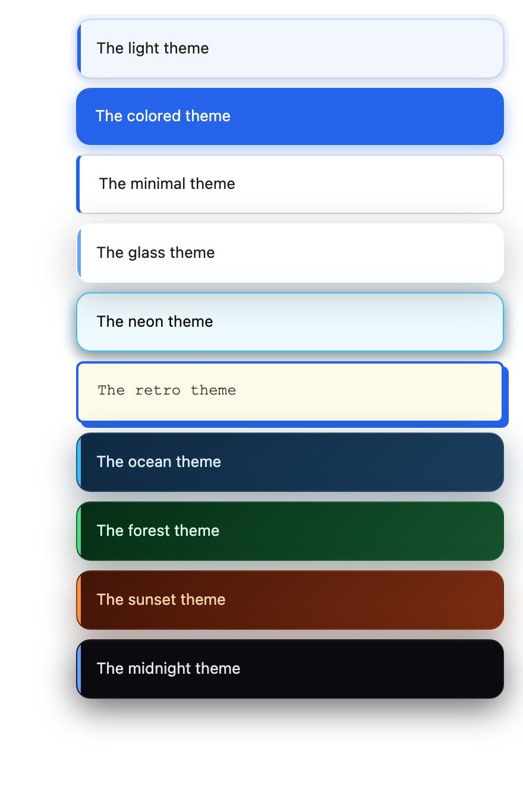
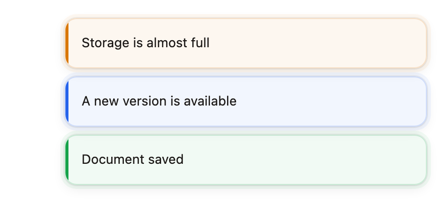
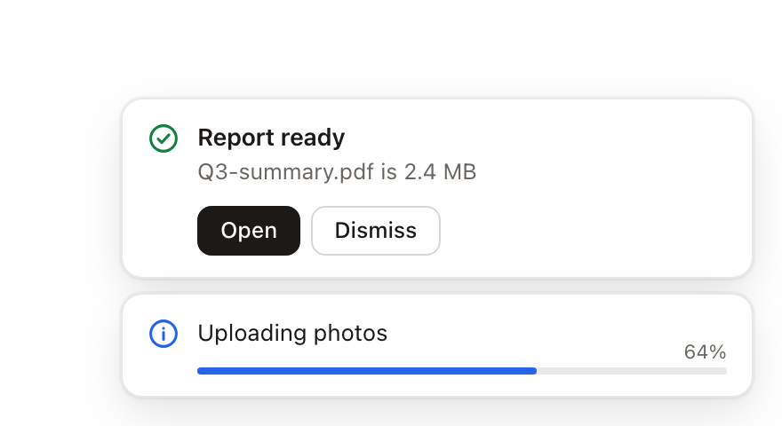
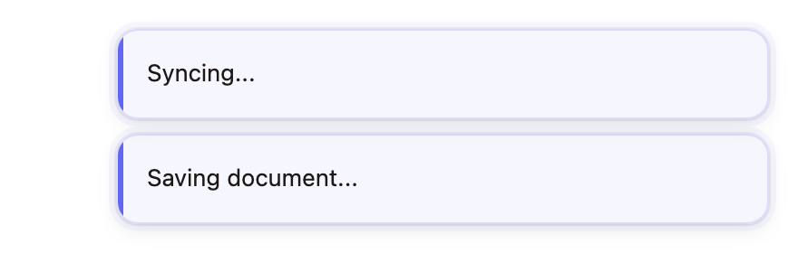
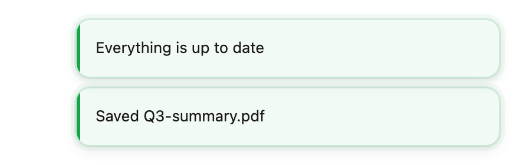
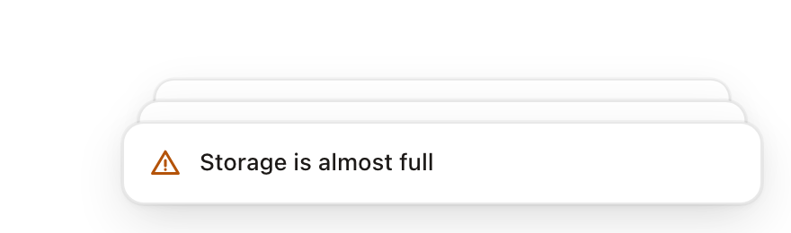
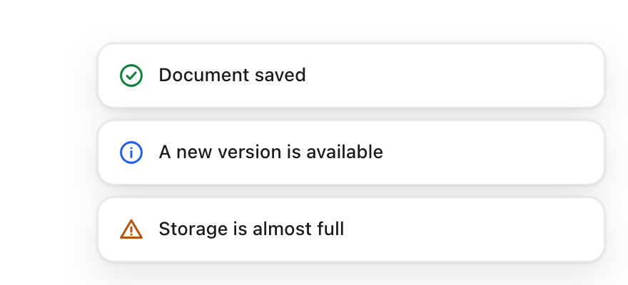
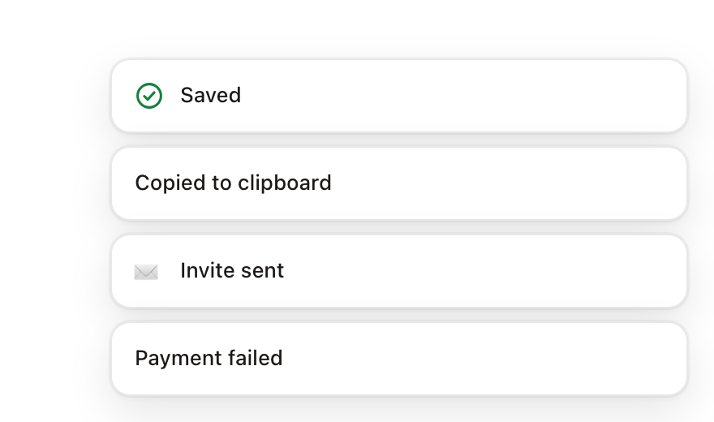
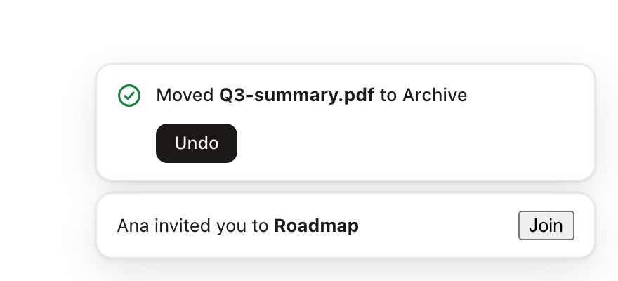
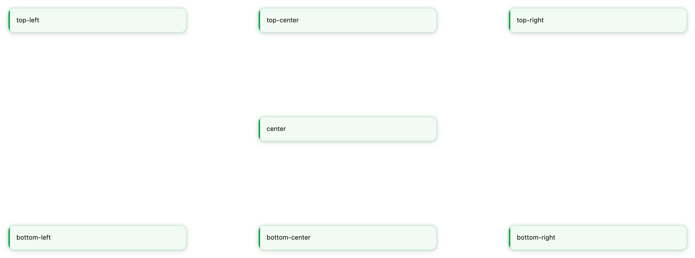

<h1 align="center">@editora/toast</h1>

<p align="center">
  Toast notifications with no dependencies, nothing to mount and no CSS to import: call <code>toast.success('Saved')</code>
  from anywhere. Status icons, a stack that opens on hover, promise toasts, actions, progress, light and dark, keyboard
  access, and JSX in React.
</p>

<p align="center">
  <a href="https://www.npmjs.com/package/@editora/toast"></a>
  <a href="https://www.npmjs.com/package/@editora/toast"></a>
  <a href="https://github.com/ajaykr089/Editora/blob/main/LICENSE"></a>
  <a href="https://www.npmjs.com/package/@editora/toast"></a>
</p>

<p align="center">
  <a href="https://editora-ecosystem.netlify.app/toast-demo.html">Live demo</a> ·
  <a href="https://editora-ecosystem-storybook.netlify.app/">Storybook</a> ·
  <a href="https://github.com/ajaykr089/Editora">GitHub</a>
</p>

<p align="center">
  
</p>

## Features

- **Nothing to mount, no CSS to import.** No provider, no container element, no stylesheet: the first call creates
  what it needs and puts the styles on the page. It works from React, Vue, plain JavaScript, a service, or an event
  handler.
- **JSX in React.** `@editora/toast/react` takes JSX wherever text goes, and `toast.custom()` shows your own component in
  the toast. `<Toaster />` renders it with your app's context.
- **A modern card.** An opaque, neutral surface with a status icon (a different shape for each level, so colour is
  never the only cue), in light and dark. Dark follows the system, or your app's own `.dark` switch.
- **A stack that opens on hover.** Several toasts fold into a deck, the newest in full; hover it or focus it and it
  opens into a list while the timers wait.
- **Promise toasts.** One toast follows a promise from *loading* to *success* or *error*.
- **Actions and progress**: buttons in the toast, and a progress bar with an optional percentage.
- **Thirteen themes and seven positions**, a queue (three toasts show at once by default), duplicate prevention and
  swipe-to-dismiss.
- **Keyboard and screen readers.** Alt+T jumps to the toasts, Escape dismisses one, errors are announced as alerts and
  the rest politely, and `prefers-reduced-motion` is respected.
- **Small.** 15 KB gzipped in your app, styles included (11 KB with the [lite entry](#styles) and your own copy of
  toast.css). The spring, bounce and other animations load only if you use one. No dependencies.
- **Safe on the server.** The package imports in Node and the calls do nothing there, so a call in shared code does not
  break server rendering.
- Written in TypeScript. A script tag works too (a UMD build).

## Install

```bash
npm install @editora/toast
```

## Quick start

```ts
import { toast } from '@editora/toast';

toast.success('Document saved');
toast.info('A new version is available');
toast.warning('Storage is almost full');
toast.error('Upload failed');
```

<p align="center">
  
</p>

Toasts appear in the bottom-right corner and go away after four seconds. Three are visible at once; the rest wait in a
queue (a fourth toast, *Upload failed* above, appears when there is room). With more than one toast showing they fold
into a deck: see [Stacking](#stacking).

`toast` is all you need. Call it with a message for a plain toast, or use `toast.info`, `toast.success`,
`toast.warning`, `toast.error` and `toast.loading`, each taking a message and, if you like, an options object or a
duration in milliseconds. `toast.show`, `toast.promise`, `toast.update`, `toast.dismiss`, `toast.clear` and
`toast.configure` cover the rest. `toastAdvanced` (also exported as `toastPro`) is the same plus groups, plugins and
subscriptions.

## Titles, actions and progress

```ts
import { toast } from '@editora/toast';

// A toast with a title, a description, actions and progress. duration: 0 keeps it until it is dismissed.
const report = toast.show({
  level: 'success',
  title: 'Report ready',
  description: 'Q3-summary.pdf is 2.4 MB',
  actions: [
    { label: 'Open', primary: true, onClick: () => console.log('open') },
    { label: 'Dismiss', onClick: () => report.dismiss() }
  ],
  duration: 0
});

const upload = toast.show({
  level: 'info',
  message: 'Uploading photos',
  progress: { value: 64, showPercentage: true },
  duration: 0
});
```

<p align="center">
  
</p>

`show()` returns the toast: `dismiss()` removes it and `update(options)` changes it. Pressing an action runs its `onClick`
and closes the toast; give the action `dismissOnClick: false` to keep the toast open. The progress bar follows
`update(id, { progress })`.

## Promises and updates

`toast.promise()` shows one toast that becomes the result of a promise, and `update()` changes any toast by id:

```ts
import { toast } from '@editora/toast';

const saveDocument = new Promise<{ name: string }>((resolve) => {
  setTimeout(() => resolve({ name: 'Q3-summary.pdf' }), 1500);
});

// One toast that moves from loading to success or error by itself.
toast.promise(saveDocument, {
  loading: 'Saving document...',
  success: (file) => `Saved ${file.name}`,
  error: (error) => `Could not save: ${error.message}`
});

// Or update a toast yourself.
const sync = toast.loading('Syncing...');
setTimeout(() => {
  toast.update(sync.id, { message: 'Everything is up to date', level: 'success' });
}, 2500);
```

<table>
  <tr>
    <td></td>
    <td></td>
  </tr>
  <tr>
    <td align="center"><sub>While it works</sub></td>
    <td align="center"><sub>After the promise resolves and the update</sub></td>
  </tr>
</table>

`toast.promise()` returns the promise you gave it, so you can still `await` it. If you only need the message, `success`
and `error` can be plain strings; they can also be options (`{ title, description, actions }`), which replace the
loading text.

## Stacking

```ts
import { toast } from '@editora/toast';

// By default several toasts fold into a deck: the newest in full, the others as edges behind it.
// Hover the deck (or press Alt+T) and it opens into a list; the timers wait while it is open.
toast.success('Document saved');
toast.info('A new version is available');
toast.warning('Storage is almost full');

// Prefer a plain list that is always open?
// toast.configure({ stack: false });
```

<table>
  <tr>
    <td></td>
    <td></td>
  </tr>
  <tr>
    <td align="center"><sub>Folded</sub></td>
    <td align="center"><sub>Hovered or focused</sub></td>
  </tr>
</table>

The newest toast is always the one nearest the edge of the screen. While the deck is open, the timers of its toasts wait,
and a toast that arrives meanwhile waits with them. A toast that is dismissed leaves at once and the others close the gap.
`stack: false` keeps a plain list; `stack: true, expand: true` shows a list that is always open.

On a touch screen a tap opens the deck; a tap elsewhere closes it.

## Icons

```ts
import { toast } from '@editora/toast';

// A list instead of a deck, so all four are visible at once.
toast.configure({ maxVisible: 4, stack: false });

toast.success('Saved');                              // the icon of the level
toast('Copied to clipboard');                        // no level, no icon
toast.info('Invite sent', { icon: '✉️' });           // your own: text, an emoji or a DOM node
toast.error('Payment failed', { icon: false });      // none

// Or switch the built-in icons off everywhere:
// toast.configure({ icons: false });
```

<p align="center">
  
</p>

The built-in icons are drawn in SVG from the level's colour (`--et-success`, `--et-error`, ...) and are hidden from screen
readers; the message carries the meaning. `icon` takes a string (text or an emoji), a DOM node, or `false`.

## In React, and in any framework

There is nothing to render. Call `toast` from a handler, an effect or a service:

```tsx
import { toast } from '@editora/toast';

async function saveDraft() {
  await new Promise((resolve) => setTimeout(resolve, 800));
  return { name: 'draft.md' };
}

// There is nothing to mount: call toast from any handler or effect.
export default function SaveButton() {
  return (
    <button
      onClick={() =>
        toast.promise(saveDraft(), {
          loading: 'Saving...',
          success: (file) => `Saved ${file.name}`,
          error: 'Could not save'
        })
      }
    >
      Save
    </button>
  );
}
```

### JSX

For React content, import from `@editora/toast/react`. It is the same `toast`, except that the title, the message, the
description and the icon can be JSX, and `toast.custom()` shows a component of your own:

```tsx
import { Toaster, toast } from '@editora/toast/react';

export default function App() {
  function archive() {
    // JSX goes anywhere text does: the title, the message, the description, the icon.
    toast.success(
      <span>
        Moved <strong>Q3-summary.pdf</strong> to Archive
      </span>,
      { action: { label: 'Undo', onClick: () => toast.info('Moved back') } }
    );
  }

  function invite() {
    // A toast made of your own JSX, in the toast card, with a function that dismisses it.
    toast.custom(
      ({ dismiss }) => (
        <div style={{ display: 'flex', alignItems: 'center', gap: 12 }}>
          <span style={{ flex: 1 }}>
            Ana invited you to <strong>Roadmap</strong>
          </span>
          <button onClick={dismiss}>Join</button>
        </div>
      ),
      { duration: 0 }
    );
  }

  return (
    <>
      {/* Once, inside your providers: it renders the JSX of the toasts, with your app's context. */}
      <Toaster position="bottom-right" />
      <button onClick={archive}>Archive</button>
      <button onClick={invite}>Invite</button>
    </>
  );
}
```

<p align="center">
  
</p>

`<Toaster />` renders that JSX into the toasts through portals, so it sees the context of the place it is mounted
(a theme, a router, a translation provider): mount it once, inside your providers. It renders nothing else, and its props
are the [settings](#configure-it). Text does not need it; a toast with JSX and no `<Toaster />` says so in the console.

The JSX keeps its state while the toast is updated (`toast.update(id, { title: <b>New</b> })` swaps the title in place),
and goes when the toast does. `toast.promise` takes JSX for each state, or a function that returns it, and keeps the
loading toast however long the promise takes.

[`@editora/ui-react`](https://www.npmjs.com/package/@editora/ui-react) also has a `ToastProvider` and a `useToast()` hook
if you like a provider.

## Styles

The styles are built in. The first toast puts them in a `<style>` at the start of `<head>`, so your own CSS still wins,
and only if `toast.css` is not on the page already. Under a content security policy, give it your nonce:
`configure({ nonce })`, or a `<meta property="csp-nonce" nonce="...">` (which Vite writes for you) is read.

To load the stylesheet as a file instead (a CSS pipeline, or a policy that allows no inline styles), import the lite
entry, which has the same API without the built-in copy, about 5 KB gzipped smaller:

```ts
import { toast } from '@editora/toast/lite';
import '@editora/toast/toast.css';

// The same API, styled by your copy of toast.css (the lite entry has no built-in one).
toast.success('Styled by toast.css');
```

`configure({ injectStyles: false })` does the same with the main entry. Restyle toasts with the `--et-*` variables or by
overriding `.editora-toast` (see [Themes](#themes)).


## From a script tag

The UMD build defines three globals: `toast`, `toastAdvanced` and `toastPro` (the same object as `toastAdvanced`), and
brings its styles, as the main entry does. Pin a version in production, as here:

```html
<script src="https://cdn.jsdelivr.net/npm/@editora/toast@2/dist/index.umd.js"></script>

<button id="save">Save</button>

<script>
  document.getElementById('save').onclick = () => {
    // The script defines three globals: toast, toastAdvanced and toastPro (the same object as toastAdvanced).
    toast.success('Saved from a CDN');

    const notification = toastAdvanced.show({
      message: 'File uploaded',
      level: 'success',
      actions: [
        { label: 'View', onClick: () => console.log('view') },
        { label: 'Dismiss', onClick: () => notification.dismiss() }
      ],
      duration: 0
    });
  };
</script>
```

## Configure it

`configure()` sets the defaults for every toast from then on. A single toast can still override them:

```ts
import { toast } from '@editora/toast';

// Settings for every toast from now on. A toast can still override them.
toast.configure({
  position: 'top-center',
  duration: 6000,
  maxVisible: 3,
  theme: 'ocean',
  closeButton: true,
  preventDuplicate: true
});

toast.info('Welcome back');
toast.info('Welcome back'); // the duplicate is dropped
toast.warning('Your plan renews tomorrow', { theme: 'sunset', duration: 0 });
```

| Setting | Default | |
| --- | --- | --- |
| `position` | `'bottom-right'` | Where toasts appear (see [Positions](#positions)). |
| `duration` | `4000` | How long a toast stays, in milliseconds. `0` keeps it until it is dismissed. |
| `maxVisible` | `3` | How many show at once; the others wait in the queue. (`visibleToasts` is an alias.) |
| `queueStrategy` | `'fifo'` | `'fifo'` or `'lifo'`: which waiting toast comes next. |
| `theme` | `'system'` | One of the [themes](#themes). |
| `closeButton` | `false` | Show a close button on every toast. |
| `icons` | `true` | Show the built-in status icons. |
| `preventDuplicate` | `false` | Drop a toast whose content is already showing. With `dedupeScope`: `'visible'`, `'queue'` or `'all'` (the default). |
| `stack`, `expand`, `gap` | `true`, `false`, `8` | A deck that opens on hover (`stack`), a list that is always open (`expand`, or `stack: false`), and the gap between toasts. |
| `pauseOnHover`, `pauseOnFocus`, `pauseOnWindowBlur` | `true`, `true`, `false` | Hold the timers while the pointer is over the stack, a toast has keyboard focus, or the window is in the background. The time that was left is kept. |
| `hotkey` | `'alt+t'` | A shortcut that moves focus to the toasts, for example `'ctrl+shift+k'`; `false` turns it off. |
| `swipeDismiss`, `swipeDirection`, `dragDismiss` | `true`, `'any'`, `false` | Dismiss by swiping, in which direction, and by dragging. |
| `offset`, `mobileOffset`, `zIndex` | `16`, `16`, none | The distance from the edge of the screen, on desktop and on mobile, and the stacking order. |
| `rtl` | `false` | Right-to-left layout. |
| `richColors` | `false` | Tint each toast with the colour of its level. |
| `container` | the page body | The element toasts are added to. |
| `injectStyles` | `true` | Put the built-in styles on the page with the first toast (see [Styles](#styles)). |
| `nonce` | from `<meta property="csp-nonce">` | The nonce for that `<style>`, under a content security policy. |

`toast.getConfig()` (on `toastAdvanced`) returns the current settings.

## Themes

`light`, `dark`, `system`, `colored`, `minimal`, `glass`, `neon`, `retro`, `ocean`, `forest`, `sunset`, `midnight` and
`custom`. Set one for all toasts with `configure({ theme })`, or for one toast with `{ theme }`:

```ts
import { toast } from '@editora/toast';

// A deck would fold these into one; stack: false keeps them in a list.
toast.configure({ position: 'top-right', maxVisible: 12, stack: false, gap: 8 });

const themes = [
  'light', 'dark', 'colored', 'minimal', 'glass', 'neon', 'retro', 'ocean', 'forest', 'sunset', 'midnight'
] as const;

for (const theme of themes) {
  toast.info(`The ${theme} theme`, { theme, duration: 0 });
}
```

The picture at the top of this page is that code. `system` (the default) follows the operating system's light or dark
setting, and your app's own switch: a `dark` class, or `data-theme="dark"`, `data-bs-theme="dark"`,
`data-color-scheme="dark"` or `data-mantine-color-scheme="dark"` on the `<html>` element (and `light` for an app that is
light while the system is dark). Each toast carries `data-theme` and level classes (`editora-toast-info`, ...).

A theme is a set of CSS variables, so you can make your own with a few lines (the `custom` theme leaves the colours to you):

```css
.editora-toast[data-theme="custom"] {
  --et-bg: #fffbeb;
  --et-text: #292524;
  --et-text-muted: #78716c;
  --et-border: #fcd34d;
  --et-success: #15803d; /* the colour of the success icon; also --et-error, --et-warning, --et-info, --et-loading */
  --et-radius: 16px;
}
```

`--et-width`, `--et-font`, `--et-shadow`, `--et-action-bg` and `--et-action-ink` (the primary button) are variables too.

## Positions

`top-left`, `top-center`, `top-right`, `bottom-left`, `bottom-center`, `bottom-right` and `center`:

```ts
import { toast } from '@editora/toast';

toast.configure({ maxVisible: 10 });

const positions = [
  'top-left', 'top-center', 'top-right',
  'bottom-left', 'bottom-center', 'bottom-right',
  'center'
] as const;

for (const position of positions) {
  toast.success(position, { position, duration: 0 });
}
```

<p align="center">
  
</p>

## Toast options

Everything `show()` accepts. All of it is optional except a message (or a title):

| Option | |
| --- | --- |
| `message`, `title`, `description` | The text, or a DOM node (a link you made, say). With `@editora/toast/react`, JSX. |
| `level` | `'info'`, `'success'`, `'warning'`, `'error'` or `'loading'`. |
| `icon` | Your own icon: a string (text or an emoji) or a DOM node; `false` for none. Left out, the level's icon. |
| `actions`, `action`, `cancel` | Buttons: `{ label, onClick, primary?, dismissOnClick? }`. |
| `progress` | `{ value, showPercentage? }`, with `value` from 0 to 100. |
| `duration`, `persistent` | How long it stays (`0`, or `persistent: true`, keeps it until dismissed). |
| `position`, `theme`, `customClass`, `rtl` | Where it appears and how it looks. |
| `closable` / `closeButton` | Show a close button. |
| `html` | Render `message` as HTML. Only inline formatting, lists and safe links are kept. |
| `render` | Build the toast yourself: `(toast) => HTMLElement`. |
| `priority`, `important` | Show higher priorities first; `important` also pushes lower-priority toasts out. |
| `preventDuplicate`, `dedupeKey`, `dedupeScope` | Drop duplicates, by content or by your own key. |
| `pauseOnHover`, `pauseOnFocus`, `swipeDismiss`, `swipeDirection`, `dragDismiss` | Behaviour; see the [settings](#configure-it). |
| `role`, `ariaLive` | Override the announcement (see [Accessibility](#accessibility)). |
| `group` | The id of a group the toast belongs to. |
| `animation` | Animation settings (a CSS animation by default; spring and other types are available). |
| `onShow`, `onHide`, `onUpdate` | Lifecycle callbacks. |

## Accessibility

Toasts live in a region that is announced politely. An **error** toast is a `role="alert"` with `aria-live="assertive"`,
so a screen reader interrupts to read it; every other level is `role="status"` with `aria-live="polite"`. The close button
is labelled "Close notification", and the icons are decorative (a different shape for each level, so a toast is not told
apart by colour alone). Override the announcement of one toast with `role` and `ariaLive`.

**Keyboard.** Every toast is a Tab stop, so its buttons can be reached before it goes away. **Alt+T** (`hotkey`) moves
focus to the newest toast and opens the stack; **Escape** dismisses the focused toast and moves on to the next one, or back
to where you were. While a toast has keyboard focus, or the pointer is over the stack, the timers wait. With
`prefers-reduced-motion` the toasts fade instead of sliding.

## API

`toast`:

| Method | |
| --- | --- |
| `toast(message, options?)` | A plain toast, with no level and no icon. |
| `info`, `success`, `warning`, `error`, `loading` `(message, options?)` | A toast of that level. |
| `show(options)` | Show a toast from full options; returns `{ id, options, dismiss(), update(options) }`. |
| `promise(promise, { loading, success, error })` | A toast that follows a promise (also `onSuccess` and `onError`); resolves with the promise's value. Each state is a message, options, or (for `success` and `error`) a function of the result that returns either. The loading toast stays until the promise settles. |
| `update(id, options)` | Change a toast. |
| `dismiss(id?)` / `clear()` | Remove one toast, or (with no id) every toast. |
| `configure(settings)` | Set the [settings](#configure-it). |

`toastAdvanced` (`toastPro`) has all of those and more:

| Method | |
| --- | --- |
| `group(id, options)` | Show a toast that belongs to a group. |
| `getConfig()` | Read the settings. |
| `getToasts()` / `getGroups()` / `getState()` | The toasts, the groups, or both with the queue and the settings. |
| `subscribe(listener)` | Call `listener(state)` when the toasts change; returns an unsubscribe function. |
| `use(plugin)` | Install a plugin: `{ name, install(manager), uninstall? }`. |
| `onEditorEvent(event, callback)` / `triggerEditorEvent(event, toast, ...args)` | Connect toasts to your editor's events. |
| `destroy()` | Remove every toast and the toast region. |

The classes and types are exported too: `ToastManager`, and `ToastOptions`, `ToastConfig`, `ToastInstance`,
`ToastPosition`, `ToastTheme`, `ToastPromiseOptions` and more. If you are upgrading from 1.x, see the
[migration guide](https://github.com/ajaykr089/Editora/blob/main/packages/editora-toast/MIGRATION_GUIDE.md).

`@editora/toast/react` exports the same `toast` (taking JSX), plus:

| Export | |
| --- | --- |
| `toast.custom(render, options?)` | A toast made of your JSX. `render` is JSX, or `({ id, dismiss }) => JSX`. |
| `<Toaster {...settings} />` | Renders the JSX of the toasts; its props are the settings. |

The types are exported too: `ReactToastOptions`, `ToasterProps`, `CustomToast`, `ToastNode`.

## Upgrading from 2.1

2.2 adds; nothing was removed or renamed.

- **No CSS import.** The styles come with the package. If you import `toast.css`, nothing changes: the built-in copy is
  only used when the stylesheet is not on the page. To keep only your file, import `@editora/toast/lite` instead.
- **JSX** with `@editora/toast/react` and `<Toaster />`, and DOM nodes as `title`, `message` and `description`.
- **toast.promise** keeps the loading toast until the promise settles. Before, a promise slower than `duration` lost its
  toast, and the result was never shown. A result can be options returned by a function:
  ``success: (file) => ({ title: `Saved ${file.name}`, description: 'In Drafts' })``.
- **Smaller**: the named animations (spring, bounce, slide...) are a separate file, loaded the first time one is used.
- The package no longer sets the `browser` field: bundlers that read it (webpack 4) now get the ES module build rather
  than the UMD one. The UMD file is where it was, for `<script>` tags and CDNs.

## Upgrading from 2.0

2.1 changes how toasts look and where they sit; nothing was removed.

- **The look.** The card is opaque and neutral, with a status icon, instead of a see-through tint with a coloured stripe
  (the page showed through the text). The `dark` theme is dark (it was a white card), and the primary button is readable in
  dark mode. `richColors` gives the tinted card back. `configure({ icons: false })` removes the icons.
- **Stacking.** Several toasts fold into a deck by default, and the newest toast is nearest the edge of the screen (it
  used to be farthest). To get a plain list: `configure({ stack: false })`.
- **Timers.** Hovering or focusing the stack holds every toast and keeps the time that was left; before, each toast was
  held on its own and started again from the full duration.
- **Keyboard.** Toasts are Tab stops, Alt+T and Escape work, and `pauseOnFocus` is on. `configure({ hotkey: false })` turns the shortcut off.
- **The simple API** gained `toast(message)`, `promise`, `update`, `dismiss`, `clear`, `configure` and `show`.
- **Browsers.** The layout uses the individual `translate` and `scale` properties: Chrome 104, Safari 14.1, Firefox 72 or later.
- If you styled toasts with CSS, the accent stripe (`::before`) and the tinted `background` of the level classes are gone: set
  `--et-*` variables or `--et-accent`, or restyle `.editora-toast`.

## Part of Editora

[`@editora/ui-react`](https://www.npmjs.com/package/@editora/ui-react) depends on this package.

## License

MIT © [Ajay Kumar](https://github.com/ajaykr089)
